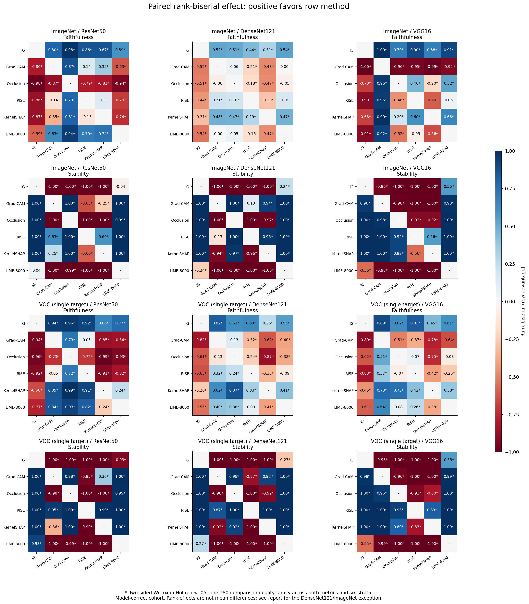

# A：IG、Grad-CAM 方法说明与答辩准备

2026-10-26 · 对应 [#18](https://github.com/oioioi-521/GO3-XAI01-04/issues/18)。本文可作为最终报告 §2.3、§3 的方法补充和答辩材料；统计来源为 D 的 DCU 六方法批次，不混入 A 的历史 RTX 2080 Ti 数值。

## 1. 原理与实际实现

### Integrated Gradients

IG 沿基线到输入的路径积分目标输出对输入的梯度，再按输入与基线的差缩放，描述各输入特征对输出变化的贡献。原始定义与公理讨论见 [Sundararajan 等，ICML 2017](https://proceedings.mlr.press/v70/sundararajan17a.html)。

本项目使用 Captum 对真值类别的 logit 做归因，以归一化后的 RGB 黑图为基线，50 步 Gauss-Legendre 近似、内部 batch=10。每通道的有符号归因先取通道均值，再作空间 min-max 到 [0,1]，保存 float32。min-max 保留投影后图值的空间排序，但输出图的零表示本图最小贡献，不能解释成原始贡献为零；原始 IG 的完整性性质不能直接套到归一化后的二维图数值。

实现：[integrated_gradients.py](../experiments/attribution/integrated_gradients.py)、[gradient_common.py](../experiments/attribution/gradient_common.py)。冻结预算见[正式运行记录](DCU_FULL_RUN_20261013.md)。

### Grad-CAM

Grad-CAM 利用目标输出对选定特征层的梯度给通道加权，对加权特征求和后施加 ReLU，得到目标相关的粗粒度区域图。原理见 [Selvaraju 等，ICCV 2017](https://arxiv.org/abs/1610.02391)。

本项目使用 Captum LayerGradCam，目标为真值类别 logit，开启 ReLU 和通道求和；目标层为 ResNet50 `layer4.2`、DenseNet121 `features.norm5`、VGG16 `features.28`。随后双线性上采样到 224×224，并除以最大值；全零图保持零。它不沿黑图积分，统一接口中的 baseline 参数只用于契约校验，评价阶段的删除操作仍使用黑色基线。

实现：[grad_cam.py](../experiments/attribution/grad_cam.py)。特征层分辨率和插值使其空间粒度与像素梯度方法不同；当前较高噪声稳定性不能直接证明它更忠实。

## 2. 正式结果与配对证据

主分析为各模型命中组，ImageNet n=408/371/363，VOC n=387/388/400（ResNet50/DenseNet121/VGG16）。以下数值直接取自 [D 统计 JSON](../analysis/dcu_20261015/statistics.json) 的 `method_pairs`，每行保留同图配对。

| 数据集 / 模型 | 指标 | n | IG 均值优势 | 边际 95% CI | IG 秩二列效应 | Holm p |
| --- | --- | ---: | ---: | --- | ---: | ---: |
| ImageNet / ResNet50 | AUC | 408 | +0.05390 | [+0.04984, +0.05793] | +0.801 | 8.31e-43 |
| ImageNet / ResNet50 | 稳定性 | 408 | -0.32169 | [-0.33030, -0.31323] | -1.000 | 2.43e-66 |
| ImageNet / DenseNet121 | AUC | 371 | +0.01412 | [+0.00830, +0.01985] | +0.520 | 1.69e-16 |
| ImageNet / DenseNet121 | 稳定性 | 371 | -0.23995 | [-0.24827, -0.23184] | -1.000 | 2.01e-60 |
| ImageNet / VGG16 | AUC | 363 | +0.26566 | [+0.25186, +0.27962] | +0.997 | 8.36e-59 |
| ImageNet / VGG16 | 稳定性 | 363 | -0.14106 | [-0.14861, -0.13364] | -0.958 | 2.11e-54 |
| VOC / ResNet50 | AUC | 387 | +0.10669 | [+0.09981, +0.11345] | +0.943 | 4.12e-56 |
| VOC / ResNet50 | 稳定性 | 387 | -0.41895 | [-0.43215, -0.40592] | -1.000 | 5.44e-63 |
| VOC / DenseNet121 | AUC | 388 | +0.12412 | [+0.11438, +0.13377] | +0.822 | 8.5e-43 |
| VOC / DenseNet121 | 稳定性 | 388 | -0.29389 | [-0.30568, -0.28205] | -1.000 | 3.98e-63 |
| VOC / VGG16 | AUC | 400 | +0.25182 | [+0.23214, +0.27188] | +0.894 | 3.22e-52 |
| VOC / VGG16 | 稳定性 | 400 | -0.18570 | [-0.19625, -0.17459] | -0.977 | 3.52e-62 |

AUC 优势定义为 Grad-CAM−IG，正数表示 IG 的 AUC 更低；稳定性优势定义为 IG−Grad-CAM，负数表示 Grad-CAM 更稳定。区间是配对均值差的边际 95% CI；p 值来自配对 Wilcoxon，经 180 项质量比较族 Holm 校正。不能将 Wilcoxon 称为均值差检验。

六组中 IG 的平均 AUC 都更低，Grad-CAM 的平均噪声稳定性都更高；12 个配对均值差区间均支持对应方向，校正后的秩检验亦均显著。六组记录归因时间也都由 Grad-CAM 更低，但这些时间来自共享机器上的实际运行，不能外推为独占硬件速度保证。

图中包含六方法完整配对证据；本节选取 A 负责的两方法解释，不能把两方法比较写成“IG 在所有方法、所有条件下最优”。ImageNet/DenseNet121 中 IG 与 KernelSHAP 的例外见[最终报告 §3](FINAL_REPORT_DRAFT.md#3-rq1哪些条件下存在优势模式)。

## 3. 可以直接用于汇报的讲述

我们负责两种梯度类方法：IG 从黑色基线到输入进行路径积分，Grad-CAM 利用模型内部特征层及梯度生成区域解释。为了让实验可比较，两者使用相同图片、真值目标和评价协议，保存 float32 归因图，并在每张原图上做五次配对输入噪声测试。

在当前 DCU 正式批次的六个模型/数据集组合中，IG 相对 Grad-CAM 的平均删除 AUC 更低，配对区间和秩检验支持这一方向；Grad-CAM 则有更高的平均输入噪声稳定性和更低的记录时间。这说明“解释质量”需要拆成不同目标来讨论。我们据此给出候选选择规则，同时保留固定预算、图像子集、目标响应和共享机器计时的限制。

## 4. 答辩问题与回答依据

**为什么用真值类别，而不是预测类别？**

实验固定 metadata 目标，使同图、同模型的六方法解释同一个类别。预测命中组用于主分析，全部样本保留作敏感性分析；错误预测样本上的真值归因不能写成“解释了模型实际预测的类别”。VOC 的命中只针对冻结单目标。

**黑色基线就是归一化后的零张量吗？**

不是。黑色是 RGB=0，经过 mean/std 后是 `-mean/std`。归一化张量全零对应均值颜色，会改变 IG 路径和删除评价的含义。

**IG 的低 AUC 是否说明其热图在语义上总是正确？**

低 AUC 表明按当前排序删去像素后，目标分数在该删除协议下更低。它受基线、输出尺度和删除后的分布变化影响，不等同于定位标注准确率或人类语义正确性。需要结合真实案例和其他指标。

**为什么 Grad-CAM 更稳定？**

当前数据支持其相对 IG 的输入噪声稳定性更高。较粗特征图、ReLU 和插值可能有影响，但本项目没有隔离这些因素做因果实验，因此只将其作为解释假设，不写成已证实机制。

**常量 Grad-CAM 怎样处理？**

未定义的 Spearman 留空，按冻结协议把对应 score 记为 0，同时报告 valid rate。36 单元批次中 Grad-CAM 有 28 条退化重复；没有删除这些记录，也没有把常量图解释为完美稳定。

**五次噪声能否把样本量写成 460×5？**

不能。先把五次分数按原图汇总，推断单位仍是原图。置信区间与配对检验保留方法间的同图关系；跨模型只使用共同命中组。

**为什么显著秩检验与均值差区间会有不同方向？**

它们针对不同统计量，差值分布与尾部可以影响均值和秩。DenseNet/ImageNet 的 IG/KernelSHAP 正是需要完整披露的例外；均值差 CI 跨零时，不依据一个秩检验 p 值声称均值显著更低。

**是否已经完成三因素 ANOVA？**

尚未。已完成的是逐单元配对检验、效应量、区间、多重比较、跨模型配对及探索性分析。因子主效应与交互要求由 #21 收尾，最终报告将按实际结果更新。

**LIME 向量化提速是否改变算法或者提高了解释质量？**

历史 debug 回归中 720 张 map 与 weighted R² 和参考实现逐值一致；相同 batch32 的六组合各三图配对测速为 4.36–7.36 倍。它降低实现成本，但没有证明解释质量提高，也不是原版全量墙钟对照。

## 5. 本人的交付与待协作项

已写成：两方法原理和实现说明、正式配对结果、可用于汇报的讲述及上述答辩回答。待 B/E 交真实案例后补充案例讲述；待 D 的统计收尾和方法选择复核后统一冻结结论。完整计时演练需全组实际参加，本文准备不等于已经完成演练。
