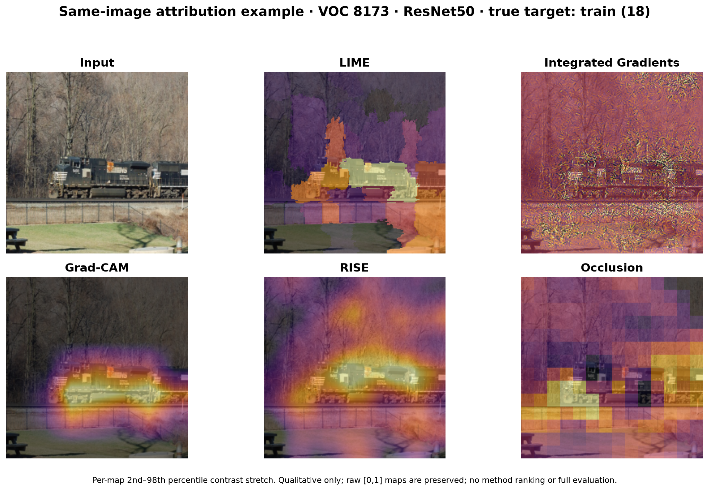

# D 对 E 的 LIME 中期材料受限接收记录

复核日期：2026-10-12。仅运行 D 编写的读取校验器，不执行 ZIP 内的复现脚本。

接收包 `LIME-E-midterm-20261010.zip`，17 个文件；整包 SHA-256：
`54b86c4c9c1e7a72e9345c99eb474458d8613c28fc8758a93aea2ac84446482f`。
可机器读取的核对记录见 [`analysis/lime_midterm_receipt.json`](../analysis/lime_midterm_receipt.json)。

## 已独立核对的示例

原面板原样复制，未重算或修改图像。PNG SHA-256 为
`bd122ce269ec5889f8a892e91d27b5e8d2823fb7d50dad4e1a6d47f617a29c0f`。

- ZIP 路径/重复名、CRC 通过；PNG 可完整解码且已目视检查布局。
- LIME、IG、Grad-CAM、RISE、Occlusion 的五份 NPY 都是有限 `float32 224×224 [0,1]`，
  无常量图，与 NPZ 中对应数组逐元素一致。
- 图像为冻结 VOC debug `8173`、ResNet50、metadata 真值 `train (18)`；本地输入 JPEG
  与 checkpoint 字节 SHA-256 均和 manifest 一致。LIME map SHA 与其附带 provenance 一致。
  这些核对支持接收示例，不等于独立重新执行五方法或证明所有生成时来源。
- 可用于中期讨论：LIME 呈超像素块状解释，Grad-CAM 和 RISE 更集中于火车附近；
  IG 显示细粒度纹理，Occlusion 呈窗口块状响应。这是一张图的定性观察，不能推出方法优劣。
- 各图单独 2%–98% 分位拉伸；RISE 只有 256 masks，非正式 4000-mask 设置。
  面板为 CPU 示例，不能和 GPU 正式效率混合排名。

## 六组门禁摘要：一致性已核对，运行尚未独立验收

附件 JSON/CSV 报告六组各 40 图、240 maps、120 个预算对、0 常量图；相应共享字段一致。
最终状态记录六组完成且停在正式 eval 前；较早五组状态不能当当前状态。

| 模型 / 数据集 | 报告的 1000/2000 预算平均 Spearman | 2000 预算 seed-pair P10 |
|---|---:|---:|
| ResNet50 / ImageNet | 0.947294 | 0.759620 |
| ResNet50 / VOC | 0.978344 | 0.901954 |
| DenseNet121 / ImageNet | 0.890509 | 0.590950 |
| DenseNet121 / VOC | 0.962763 | 0.842183 |
| VGG16 / ImageNet | 0.893347 | 0.561047 |
| VGG16 / VOC | 0.954394 | 0.838706 |

以上是 E 的摘要值，D 没有原始门禁 arrays/逐图 pairs/日志可重算这些统计。
**不把 seed 预算比较当 Issue #8 的 RGB-noise 正式稳定性。**

耗时暂不验收：六组的 `estimated_attribution_seconds` 与按 120 张/预算乘对应
`mean_attribution_ms` 推算的总量不一致。例如 ResNet50/ImageNet 摘要估算为
3872.474 s，按摘要均值推算为 8441.422 s；可能涉及计时分母、重试或恢复范围差异，
此包无法区分。该组 `measured_gate_wall_seconds` 为空。不得据此外推精确正式耗时。

## 正式启动前仍需 E 提供

1. 可复核的 LIME adapter、六份 YAML、分割/回归/seed 契约与对应固定提交。
2. 六组门禁原始逐图预算/seed pairs、日志、环境、配置哈希、maps/provenance 清单。
3. 耗时字段分母和恢复/重试范围说明；解释 ImageNet DenseNet/VGG 的低 seed 相似度。
4. 审阅后冻结正式预算，再决定 460 张基础 eval 与冻结稳定性补跑。

本次包明确 `formal_budget_frozen=false`、`formal_evaluation_started=false`。
D 接收中期示例，不认证 E 的完整代码、六组真实运行或正式结果完成。

## 2026-10-13 后续代码审查

上面的缺项是 2026-10-12 接包时的状态，保留作为历史回执。E 已上传代码和七份 LIME
YAML（六份候选、一份 smoke），固定提交 `64d2ffde8a1c206d6b5bac9cc8b2c83622e702cb`。
D 已独立复测 26 项 LIME 专项、94 项全仓和两个 CPU 合成 smoke，工程链路通过。
附加探针复现了门禁续跑的记录完整性/target/统计校验缺口，以及输入图片字节未绑定计划身份。
代码已具备审查对象，不再将“代码未提供”当当前缺项，但原始门禁包、缺口修复和预算审阅仍待完成。
详见 [固定提交审查与复现步骤](D_LIME_CODE_REVIEW_20261013.md)，不据此认证真实六组实验或冻结预算。

复核入口：`python -m analysis.validate_lime_midterm_delivery <ZIP> --report analysis/lime_midterm_receipt.json --panel analysis/lime_midterm_same_image.png`。
