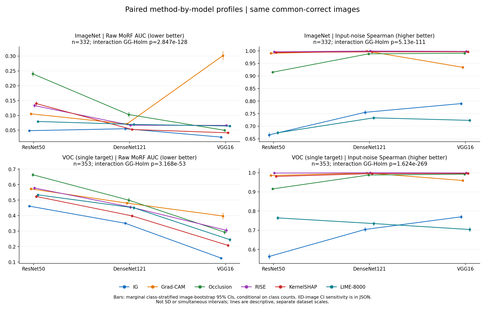
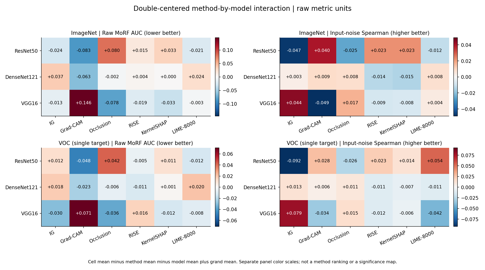

# D：方法/模型重复测量主效应与交互结果（2026-10-28）

本次交付对应 #21 的按数据集分开的阶段分析。使用已完成的六方法×三模型×两数据集冻结结果，
没有重跑 GPU、修改原 CSV 或替代全组最终验收。**数据集因子和完整混合三因素 ANOVA 仍未完成。**

## 1. 设计和检验

主分析为三模型共同命中组：ImageNet n=332、VOC n=353；全 eval 各 n=460 为敏感性。
每张原图在三模型六方法上形成完整重复测量块，五次噪声先按原协议汇总。
不同模型各自的命中组未拼入本设计，旧逐单元主分析继续保留。

对每个数据集和质量指标分别实施双图像内因子 ANOVA。
用正交 Helmert 对比投影到方法（5维）、模型（2维）、交互（10维）空间；
各效应用其自身的“原图×效应”误差，不用所有行的 pooled OLS 残差。
对比矩阵 Z 的效应平方和为 n‖平均Z‖²，误差平方和为 Σ‖Zᵢ−平均Z‖²，
F=SS效应/df效应 ÷ SS误差/df误差，原自由度为 d、(n−1)d。
在对应对比协方差 S 中计算 ε=(tr S)²/[d tr(S²)]，始终用 GG 修正后的两个自由度计算 p，
再在每 cohort 的 12 项质量全局族（两数据集×两指标×三效应）做 Holm 校正。
数值尾概率下限为1e-300，Holm使用该保守数值，避免将数值下溢导出为精确零。
不以 Mauchly 的显著/不显著来选择是否校正；记录协方差秩，不凭秩诊断悄悄删对比方向。

偏η²=SS效应/(SS效应+SS原图×效应)，不是广义η²或因果解释比例。
软件中的零误差/不可估计状态不伪造无穷 F 或 p=0。F/GG 是有分布假设的近似重复测量检验，
校正球形性自由度不代表已消除非正态、类别不均衡或命中组选择偏差。

## 2. 共同命中组正式结果

| 数据集 | 指标 | 效应 | n | F | GG ε | GG df1, df2 | GG-Holm p | 偏η² |
| --- | --- | --- | --- | --- | --- | --- | --- | --- |
| imagenet | AUC | 方法 | 332 | 276.5587 | 0.67137 | 3.357, 1111.122 | 1.104e-144 | 0.45520 |
| imagenet | AUC | 模型 | 332 | 145.8468 | 0.91199 | 1.824, 603.741 | 8.708e-49 | 0.30586 |
| imagenet | AUC | 方法×模型 | 332 | 270.8112 | 0.30154 | 3.015, 998.110 | 2.847e-128 | 0.44999 |
| imagenet | 稳定性 | 方法 | 332 | 1270.9205 | 0.32547 | 1.627, 538.650 | 1.17e-184 | 0.79337 |
| imagenet | 稳定性 | 模型 | 332 | 409.4578 | 0.95803 | 1.916, 634.214 | 5.13e-111 | 0.55298 |
| imagenet | 稳定性 | 方法×模型 | 332 | 181.2236 | 0.35957 | 3.596, 1190.186 | 5.13e-111 | 0.35380 |
| voc | AUC | 方法 | 353 | 222.9700 | 0.55329 | 2.766, 973.795 | 4.39e-103 | 0.38779 |
| voc | AUC | 模型 | 353 | 964.4893 | 0.84880 | 1.698, 597.552 | 2.467e-171 | 0.73262 |
| voc | AUC | 方法×模型 | 353 | 49.7750 | 0.55699 | 5.570, 1960.594 | 3.168e-53 | 0.12389 |
| voc | 稳定性 | 方法 | 353 | 1527.1766 | 0.34086 | 1.704, 599.906 | 2.815e-218 | 0.81268 |
| voc | 稳定性 | 模型 | 353 | 572.8924 | 0.89890 | 1.798, 632.823 | 6.825e-133 | 0.61942 |
| voc | 稳定性 | 方法×模型 | 353 | 561.8913 | 0.37318 | 3.732, 1313.609 | 1.624e-269 | 0.61483 |

交互结果：

- imagenet / AUC：F=270.8112，GG ε=0.30154，Holm p=2.847e-128，偏η²=0.44999。
- imagenet / 稳定性：F=181.2236，GG ε=0.35957，Holm p=5.13e-111，偏η²=0.35380。
- voc / AUC：F=49.7750，GG ε=0.55699，Holm p=3.168e-53，偏η²=0.12389。
- voc / 稳定性：F=561.8913，GG ε=0.37318，Holm p=1.624e-269，偏η²=0.61483。

全局交互检验问的是方法相对差异是否随这三套冻结模型/权重改变，不能从交互显著推出某方法
对所有架构都更优，也不能仅凭图上线条交叉或不同模型的 p 值不同证明交互。
主效应平均了另一因子的固定水平；存在交互时需结合逐单元配对和具体差中差解释。

## 3. 效应、不确定性与直接差中差

输出含 72 个共同命中组单元均值和边际 95% CI（含全 eval 共144行）、模型/方法边际均值、
双中心化交互单元值及其区间。采用类别分层的原图 bootstrap，10000 次，
同一抽样索引用于全部模型/方法/指标。区间条件于冻结类别比例和样本口径，不是同时区间；
单图类别在 bootstrap 中没有类内变化，原始类别不均衡及其不确定性限制继续保留。

本次明确发现：ImageNet 共同命中组194类中111类只有一张，全 eval 259类中144类只有一张；
VOC 共同命中组18类中1类只有一张、全 eval 19类中没有单图类。
因此同时另做同样次数的普通原图配对 bootstrap，允许类别比例变化，输出 `iid_image_ci95`。
两种区间都保留；类分层区间不能外推为新类别/总体比例变化或训练不确定性的区间。

差中差定义为：[a相对b的优势]在模型u − 同一优势在模型v。
AUC 优势取 −(AUCₐ−AUCᵦ)，稳定性取 Spearmanₐ−Spearmanᵦ。
正值表示 a 相对 b 的优势在 u 更大，不是 a 在所有条件中获胜。
每 cohort 有180个直接差中差；对原图的差中差做配对秩检验及符号敏感性，分别 Holm。
均值 CI 和秩 p 对应不同统计量，不将秩显著改写为均值显著。

以下示例固定 u=ResNet50、v=DenseNet121、a=IG、b=KernelSHAP；全部结果见附表：

| 数据集 | 指标 | IG相对KS优势的差中差 | 类分层95%均值CI | IID原图95%均值CI | DID秩 Holm p |
| --- | --- | --- | --- | --- | --- |
| imagenet | AUC | +0.093946 | [+0.086735, +0.101208] | [+0.082121, +0.106530] | 2.991e-44 |
| imagenet | 稳定性 | -0.087625 | [-0.090170, -0.085078] | [-0.091925, -0.083465] | 5.678e-54 |
| voc | AUC | +0.014942 | [+0.003176, +0.026916] | [-0.006141, +0.035535] | 0.8374 |
| voc | 稳定性 | -0.126126 | [-0.130140, -0.122014] | [-0.130449, -0.121883] | 2.37e-57 |

其中 VOC/AUC 这一具体差中差的类分层区间不跨零，但普通 IID 原图区间跨零，
且直接配对秩 Holm p 不显著。应同时保留这项不确定性敏感性，不能从全局交互显著
推导所有方法对/模型对都显著，也不能仅凭其中一个区间宣布 IG/KernelSHAP 的普遍优势。

## 4. 全 eval 敏感性

- imagenet / AUC：n=460，F=274.8621，GG-Holm p=3.522e-128，偏η²=0.37454。
- imagenet / 稳定性：n=460，F=235.7302，GG-Holm p=3.921e-150，偏η²=0.33931。
- voc / AUC：n=460，F=45.6883，GG-Holm p=1.484e-51，偏η²=0.09053。
- voc / 稳定性：n=460，F=579.5654，GG-Holm p=1.2e-299，偏η²=0.55804。

完整两 cohort 主效应表、单元/边际均值、交互值和直接差中差均在 JSON 中；
全 eval 不取代共同命中组，主分析也不取代原报告的各模型命中组结论。

## 5. 图与合稿用语



图1：共同命中组的六方法均值曲线；误差线为原图分层 bootstrap 的边际95% CI，不是SD。
两数据集分面且量纲/输出含义分别解释；线条为描述，图中交互 p 为效应专属误差+GG+Holm。



图2：单元均值减去模型均值与方法均值再加总体均值，保留原始指标单位；
每个面板独立色标，非显著性地图、方法排名或可跨数据集相减的质量量表。

可合稿：在冻结预算、共同命中图像及三套固定模型下，直接重复测量分析补充了方法/模型主效应
和方法×模型交互证据，需结合具体差中差及原逐单元结果解释条件优势。
原四图、IG/KernelSHAP 的均值/秩例外、Grad-CAM 退化、LIME预算及共享计时边界保持不变。

## 6. 未完成项与复现

本结果只包含按数据集分开的双因子重复测量分析，没有检验数据集主效应、数据集×方法/
模型或三重交互，不能称为完整三因素已完成或直接关闭 #21。
下一项需明确 ImageNet/VOC 作为图像间因子的尺度/语义、混合设计误差和异方差处理，
补充完整结果或经教师确认的替代处理；不需要为此重跑归因。
E 的最终 PPT/Demo 图注审核与全组冻结仍是独立事项。

```powershell
python -m analysis.dcu_repeated_measures 'dcu_team_handoff_20261014.zip'
python -m analysis.report_dcu_repeated_measures
python -m pytest -q tests/test_dcu_repeated_measures.py
```

输入 SHA：`14b6ea625f41e6c7c0587fd0073fc70e2064df0260107dca042335c6fc2303dc`；主种子 20261028；
来源/环境/代码 SHA、误差平方和、自由度、GG epsilon、全部 p 与效应均在
[repeated_measures.json](../analysis/dcu_20261028/repeated_measures.json)。
完整差中差：[附表](../analysis/dcu_20261028/direct_did_tables.md)。

实现经过 Stata 官方公开双重复因子示例的平方和、误差项、GG epsilon 与修正 p 值对照，
并检查两水平配对t²等价、加性无交互、水平置换/图像截距不变性、缺失/重复键及退化情况。
合成/参考数据测试不是本项目正式实验，不能代替 C 的独立分析复现。
另提供 [固定种子合成诊断](../analysis/dcu_20261028/synthetic_diagnostics.json)：
球形正态、异方差正态、中心化指数噪声的零交互及注入交互各1000次、每次n=60。
这只检查有限情景下的软件行为，不证明真实数据满足 ANOVA 假设或精确控制5%错误率。

方法依据：[Stata 官方重复测量示例](https://www.stata.com/support/faqs/statistics/repeated-measures-anova/)、
[Pingouin 官方双因素说明](https://pingouin-stats.org/generated/pingouin.rm_anova.html)。
[statsmodels 官方说明](https://www.statsmodels.org/stable/generated/statsmodels.stats.anova.AnovaRM.html)
明确其 AnovaRM 未实现球形性校正；本结果不把未经校正的 AnovaRM 输出冒充 GG 检验。

## 7. 验证与交付

2026-10-28：新增重复测量测试与既有统计/交接/案例测试合计 **41 passed**；
两幅新增图已渲染目视检查。旧 `analysis/dcu_20261015/` 的 JSON、配对表和四图保留，
所有新结果单独放在 `analysis/dcu_20261028/`。源码/派生摘要可通过 GitHub 交付，
原始 ZIP、原图、NPY、权重和 `outputs/` 不提交。
这次复算、软件诊断与目视检查不代替 C 的独立复现、A 的最终报告冻结或 E 的最终展示验收。
另从原CSV用独立边际均值分解核对24项效应/误差平方和、144个旧摘要均值及360个直接差中差，
均一致；[验证回执](../analysis/dcu_20261028/validation_receipt.json)记录范围和最终图像哈希。
