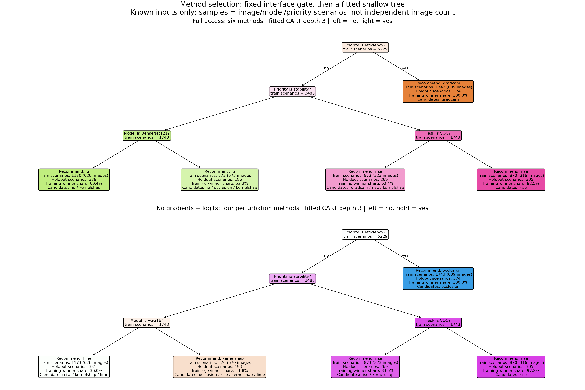
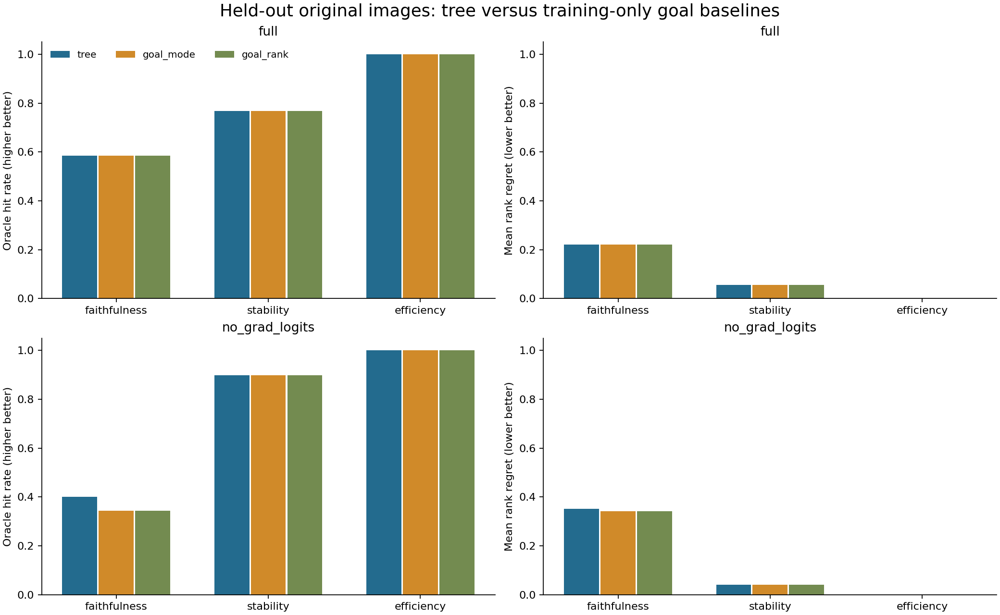

# D：基于冻结 DCU 结果的方法选择决策树

2026-11-22，选做实验 7 / [Issue #28](https://github.com/oioioi-521/GO3-XAI01-04/issues/28)。
基线为 #24 集成提交 `990929c40c0e1ee4202d4f8065d977f873cafbc7`。
这是实际拟合并留出评价的浅树，不是此前手写规则流程图；没有新增 GPU 归因。

## 可供 A 直接使用的结论

> 在冻结 DCU 批次的模型命中组内，以数据集、模型和单一优先目标为已知条件，
> 先按接口约束限制可用方法，再拟合深度 3 的方法选择子树。按原图分组留出 25% 后，
> 完整接口下，浅树仍推荐忠实性用 IG、输入噪声稳定性用 RISE、记录成本用 Grad-CAM，
> 三项目标的逐图最优方法命中率分别为 58.54%、76.83%、100%，与仅按目标推荐的简单策略完全相同。
> 无梯度但支持冻结 logit/概率响应时，忠实性子树按模型推荐 LIME 或 KernelSHAP，命中率由 34.32%
> 升至 40.07%，但平均秩损失由 0.3420 变为 0.3508，没有同步改善。因此树主要为现有指南提供
> 可复现的条件表达，不证明复杂选择器普遍更优；忠实性叶子保留多候选，尤其不将逐图多数胜利
> 改写成 ImageNet/DenseNet121 中 IG 的均值显著优势。



图 1：固定接口门禁后，各拟合一棵 CART 深度 3 子树；含接口门禁的完整策略最大深度为 4。
门禁是实现约束，非从结果学出的结论。每棵子树 5 个叶子；左分支为问题的“否”，右分支为“是”。
图内 train scenarios 是图像×模型×目标行数，images 才是该叶训练原图数，叶间原图数不可相加。
候选集合与 winner share 均仅来自训练行，不是校准概率或显著性集合。
[SVG 矢量图](../analysis/d_method_selection_20261122/method_selection_tree.svg)供报告/PPT排版使用。

## 输入、标签与接口口径

正式输入仍为 `dcu_team_handoff_20261014.zip`，SHA-256：
`14b6ea625f41e6c7c0587fd0073fc70e2064df0260107dca042335c6fc2303dc`。
运行时重新执行既有独立验收器，核对 ZIP CRC、全部清单哈希、36 单元、66,240 行指标、
82,800 条 trace、预测/权重、90 份配置及 cohort/聚合。只读取包内数据，不执行包内代码。

训练数据取 `data/per_image_model_correct.csv` 的 55,608 行：四指标×六方法，
合为 **2,317 个模型命中图像×模型组合、852 张唯一原图**。不把五次噪声重复当成新独立样本。
选方法前可知的输入只有：数据集、模型、用户声明的优先目标，以及可用接口。
编码为固定的 5 个二元条件；原图 ID、真值/预测正确标记、置信度及任何实测归因指标均不入树。
命中标记只定义本次研究 cohort，不能据此声称覆盖部署时的全部预测。

| 优先目标 | 离线推荐标签 | 评价方向 |
|---|---|---|
| 忠实性 | 同图、同模型、同数据集内 raw MoRF AUC 最低的方法 | 低优；不跨任务直接比较原始 AUC |
| 输入噪声稳定性 | 同条件平均噪声 Spearman 最高的方法 | 高优；固定方法 seed，不是掩码/联盟重采样稳定性 |
| 记录成本 | 同条件 wrapper 毫秒数最低的方法 | 低优；共享 DCU 两轮结果，不作硬件/独占运行速度保证 |

训练标签为逐图单指标最优方法。绝对差 ≤`1e-12` 视为并列，训练按固定顺序
IG、Grad-CAM、Occlusion、RISE、KernelSHAP、LIME 取首个可用方法；评价时所有并列最优都记命中。
本次实际六种目标/接口组合均未出现最优并列，处理规则不影响本次标签。
指标只用于生成标签和评价，绝不作为输入特征；所有目标行都是同一批原图的不同决策场景。

| 接口 profile | 可用方法 | 必须满足的条件 |
|---|---|---|
| full | 全部六方法 | 原实现所需输入梯度、目标层与批量扰动/响应访问均可用 |
| no_grad_logits | Occlusion、RISE、KernelSHAP、LIME | 不取梯度，允许批量扰动输入；可取得本项目需要的 logits，并采用冻结 softmax/sigmoid 响应 |

概率型 API 不能被直接视为已验收：Occlusion/KernelSHAP 使用目标 logit，RISE/LIME 原实现从 logit
计算冻结概率响应。本轮不改算法、不将概率替换为 logit；预算、目标、基线和归一化保持原实验。
接口门禁先于拟合，每棵树及其基线只能推荐自己的可用方法。

## 分组留出与评价

拟合前保存[固定方案](../analysis/d_method_selection_20261122/protocol.json)：Gini CART，
每棵最大深度 3、叶最少 100 个场景、无 class weight，随机种子 `20261122`；没有调参搜索。
使用 `GroupShuffleSplit(test_size=.25)`，group 为 `dataset + image_id`；同图在不同模型、目标、
接口以及六方法记录之间均不穿越训练/留出边界。

- 训练：639 张原图、1,743 个图像×模型组合、10,458 个目标/接口场景。
- 留出：213 张原图、574 个图像×模型组合、3,444 个目标/接口场景。
- 原图 group 交集为 0。每一目标/profile 比较的分母为相同的 574 个留出组合。
- 两个简单基线都只在训练数据学习，按目标与接口取推荐，不看模型或数据集：`goal_mode`
  取最常见最优标签；`goal_rank` 取平均秩损失最小的常量方法。本次两基线均选相同的方法。

报告 tie-aware oracle hit rate，即所推荐方法是否为该留出场景的实测最优方法；
这不是原分类模型的准确率。秩损失为“严格优于所选方法的方法数 /（可用方法数−1）”，
范围 0–1、低优，并列最优损失为 0。它避免把两数据集的 raw AUC 或不同目标的单位相加；
不同 profile 的候选数不同，秩损失也不直接作跨 profile 优劣结论。
原单位差值仅在[逐数据集/模型结果表](../analysis/d_method_selection_20261122/heldout_cells.csv)中解释。
指标按留出图像×模型场景微平均，同图跨模型相关性通过区间抽样处理。

| 接口 | 目标 | 树命中率 | 简单策略命中率 | 树平均秩损失 | 简单策略平均秩损失 |
|---|---|---:|---:|---:|---:|
| full | 忠实性 | 0.585366 | 0.585366 | 0.220557 | 0.220557 |
| full | 稳定性 | 0.768293 | 0.768293 | 0.055749 | 0.055749 |
| full | 记录成本 | 1.000000 | 1.000000 | 0.000000 | 0.000000 |
| no_grad_logits | 忠实性 | 0.400697 | 0.343206 | 0.350755 | 0.342044 |
| no_grad_logits | 稳定性 | 0.898955 | 0.898955 | 0.040070 | 0.040070 |
| no_grad_logits | 记录成本 | 1.000000 | 1.000000 | 0.000000 | 0.000000 |



对树−基线的配对差，按数据集分层、原图为 cluster 做 2,000 次 bootstrap，同图所有模型行一起抽取。
无梯度忠实性的命中率差为 `+0.057491`，边际 95% CI 对 goal_mode 为 `[+0.001733,+0.114403]`；
秩损失差为 `+0.008711`，区间 `[-0.030253,+0.046620]`。这些是探索性边际区间，未作多重比较校正，
不作“整体显著优于”结论。完整接口各留出场景预测完全相同，差值/区间均为 0，
这是策略在这些条件下相同，不是证明在任何新任务都等效。

## 叶子支持量与指南的六条规则

每个叶子用训练最优标签频率 ≥10% 的方法组成候选集合；最高频率不足 75% 时也标为需保留多候选。
这些是显式的展示阈值，不作配对显著性或个体概率解释。原始规则、各方法频率、留出支持量见
[叶表](../analysis/d_method_selection_20261122/leaves.csv)；36 种已知条件的选择见
[条件表](../analysis/d_method_selection_20261122/condition_recommendations.csv)。

| 接口/叶条件 | 推荐 | 训练场景 / 原图 | 留出场景 | 训练推荐标签占比 | 保留候选 |
|---|---|---:|---:|---:|---|
| full，忠实性，非 DenseNet121 | IG | 1170 / 626 | 388 | 69.40% | IG、KernelSHAP |
| full，忠实性，DenseNet121 | IG | 573 / 573 | 186 | 52.18% | IG、Occlusion、KernelSHAP |
| full，稳定性，ImageNet | RISE | 873 / 323 | 269 | 62.43% | Grad-CAM、RISE、KernelSHAP |
| full，稳定性，VOC | RISE | 870 / 316 | 305 | 92.53% | RISE |
| full，成本 | Grad-CAM | 1743 / 639 | 574 | 100% | Grad-CAM |
| 无梯度，忠实性，非 VGG16 | LIME | 1173 / 626 | 381 | 35.98% | RISE、KernelSHAP、LIME |
| 无梯度，忠实性，VGG16 | KernelSHAP | 570 / 570 | 193 | 41.75% | 四种扰动方法 |
| 无梯度，稳定性，ImageNet | RISE | 873 / 323 | 269 | 83.51% | RISE、KernelSHAP |
| 无梯度，稳定性，VOC | RISE | 870 / 316 | 305 | 97.24% | RISE |
| 无梯度，成本 | Occlusion | 1743 / 639 | 574 | 100% | Occlusion |

| 报告 §6 原规则 | 本轮核对 |
|---|---|
| 忠实性先考察 IG，DenseNet121/ImageNet 同看 KernelSHAP | full 树输出支持 IG 作为逐图最优标签的候选；DenseNet121 叶仅 52.18%，保留多候选。不能用多数胜利代替均值优势 |
| 稳定性先考察 RISE | 两 profile 均输出 RISE；ImageNet 的候选分散度大于 VOC，不保证每张图最优 |
| 记录成本先考察 Grad-CAM，前提可访问内部层/梯度 | full 留出 574/574 选到本批次最短 wrapper 时间；受限接口则只能在四方法里选 Occlusion，不能把 Grad-CAM 推荐给不可用接口 |
| 多目标查 Pareto 集及配对证据 | 本实验只拟合三种单目标；候选频率集合不是质量 Pareto 集，不替代原多目标规则 |
| 只能查询输出分数时先检查接口与扰动方法 | 固定门禁明确排除 IG/Grad-CAM；仅概率响应的接口仍需另行适配和验证 |
| LIME-8000 核对拟合、前沿与预算 | 受限忠实性叶可推荐 LIME，但其训练标签占比仅 35.98%、平均秩损失未优于基线；不保证局部拟合/收敛，也不推翻全接口下 IG 平均 AUC 更低的事实 |

### 必须保留的 ImageNet / DenseNet121 例外

[本轮重算表](../analysis/d_method_selection_20261122/ig_kernelshap_exception.csv)从同一冻结配对行计算：

| 划分 | n | IG 平均 AUC | KernelSHAP 平均 AUC | KS−IG 均值差 | IG / KS 逐图胜数 |
|---|---:|---:|---:|---:|---:|
| 原模型命中组 | 371 | 0.05325250 | 0.05012559 | −0.00312690 | 259 / 112 |
| 训练 | 285 | 0.05008571 | 0.05018748 | +0.00010177 | 199 / 86 |
| 留出 | 86 | 0.06374708 | 0.04992051 | −0.01382656 | 60 / 26 |

树以“最优方法标签”的分类错误率训练，输出 IG 不代表它在原单位平均损失上最好。
即使留出 86 图中 IG 在 60 图击败 KS，KS 仍有更低平均 AUC。全组既有均值差 CI
`[-0.00842328,+0.00207087]` 跨零、配对秩 Holm p=`5.15549e-6` 偏向 IG，
见[既有独立例外复算](D_M5_STATISTICAL_CONFIRMATION_20261027.md)；本轮没有重复该均值 CI 或秩检验。
标签胜率、平均原单位代价、均值推断和配对秩推断必须分开。

## 复现与文件交付

入口：[analysis/dcu_method_selection.py](../analysis/dcu_method_selection.py)。
依赖沿用仓库 requirements，CPU 即可；本轮实际 Python 3.10.20、numpy 2.2.6、pandas 2.3.3、
scipy 1.15.3、scikit-learn 1.7.2、matplotlib 3.10.9。以脚本回执的实际版本和哈希为准。

```powershell
$env:OMP_NUM_THREADS='1'
$env:OPENBLAS_NUM_THREADS='1'
.\.venv\Scripts\python.exe -m analysis.dcu_method_selection `
  --zip results/dcu_delivery_20261027/dcu_team_handoff_20261014.zip
.\.venv\Scripts\python.exe -m pytest tests/test_dcu_method_selection.py -q
.\.venv\Scripts\python.exe -m pip check
```

可用 `--out results/your_tree_review` 将重新生成的派生成果保留在忽略目录。
输出表、可移植规则 JSON 与图片见[成果目录](../analysis/d_method_selection_20261122)，
[机器回执](../analysis/d_method_selection_20261122/receipt.json)绑定输入/方案/源码/输出哈希及版本。
`policy.json` 用可读节点存储规则，无 pickle；程序实际比较 JSON 规则与 sklearn 在留出行的预测，逐行相同。
测试覆盖方向、并列、接口排除、缺失/重复配对拒绝、原图分组、特征不含结果、训练专属基线、
JSON 树等价、cluster 区间及身份错配拒绝。质量检查最终记录见同目录 `verification.json`。

本轮实际完整回归 **321 passed、2 条既有 torch.load warning**；收集后另补的图分支标签回归
随最终 **13 项专项全部通过**，两集合重叠 12 项，合计覆盖 322 个不同测试，不直接相加。
`pip check` 正常。从冻结 ZIP 在忽略目录再执行一次后，14 个成果文件的哈希及完整分析回执相同。
首轮因项目环境缺少已声明的 lime/scikit-image，以及两个临时文件 WinError 5 导致失败；
补齐项目 `.venv` 依赖并使用新临时目录复验通过，未为通过测试改动既有算法或原始实验。

逐图标签/预测和 split 清单仅写入忽略的 `results/d_method_selection_20261122/`，
其 split 哈希留在回执。原始 ZIP、NPY、权重及 outputs/ 不提交；本轮没有须从微信重发的新数据。

方法实现参照 [DecisionTreeClassifier 官方说明](https://scikit-learn.org/1.7/modules/generated/sklearn.tree.DecisionTreeClassifier.html)
与 [GroupShuffleSplit 官方说明](https://scikit-learn.org/1.7/modules/generated/sklearn.model_selection.GroupShuffleSplit.html)。
这里的真实数值来自上述冻结数据，非文档示例。

## 适用边界与 A 的整合位置

1. 这是已有六个数据集×模型组合内的原图留出，不是对新架构/新数据集留出的评价。只有两任务、
   三套冻结模型/权重；不外推到未知模型、预算、目标定义或未命中样本。
2. 方案在首次拟合前保存、未用留出结果调深度/剪枝/阈值；但分析者此前已阅读全批次统计和指南，
   本轮不是盲测或全新外部测试。留出仅隔离本次拟合与逐图评价。
3. 一个原图可产生多个模型/目标/profile 场景，13,902 行不是 13,902 个独立样本。
   bootstrap 只覆盖本次留出图的条件抽样差异，不涵盖重新训练树、新权重或新任务的不确定性。
4. 原始 AUC、噪声定义、共享计时和固定归因预算的既有局限全部保留。没有对选择器宣称因果最优、
   个体保证或任意目标权重下的最佳多目标方法。

A 可将本页“可直接使用的结论”、图 1、留出对照及 §6 核对表纳入新版报告/PPT。
原 v4 中“流程图未经训练”的句子描述旧图，整合新版时须改为“原规则图与本轮已拟合决策树分别交付”。
本分支只交 D 的新增成果，不替 A 改写报告/PPT，不关闭 Issue 或合并 main；
E 的聚类 #27、新版共同口径复核与实际计时按 #18 继续。
