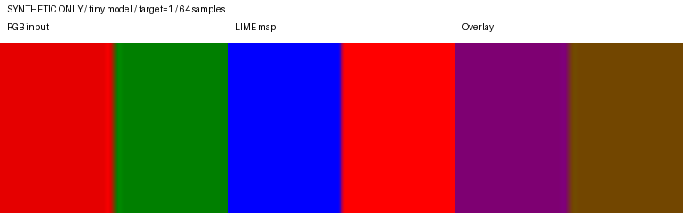

# 成员 E：LIME 进度（2026-10-13）

当前代码位于本地分支 `feat/e-lime-local`，基于 `integrate/a-voc-eval` 的
`00d73b4d10f9fbea32656951be05ddc336aab893`。本记录总结代码验收和两份 4080/服务器交接包；
原始数据、模型、逐图结果和机器专用控制脚本不纳入仓库。

## 已完成

- 接入统一 attribution 与 runner：接受 metadata 真值 target，按配置输出有限的 CPU float32
  attribution map；配置记录 quickshift、随机种子、采样、kernel、Ridge 和 baseline 参数。
- 提供六个模型/数据集候选配置、真实 debug 单图 smoke 配置、固定 40 张 debug 预算比较工具，
  并保留正式 eval 的预算冻结保护、21 点 raw MoRF、一次不计时 warm-up 和安全续跑契约。
- 在项目 `.venv` 中复测：LIME 专项 26 项通过，全仓 94 项通过；合成 tiny-model smoke 首次
  处理 1 张、立即续跑跳过 1 张，float32 图有限且哈希稳定。此 smoke 只验证管线，不是模型或数据集结果。
- 2026-10-13 服务器交接包记录六个单元的 2000 样本单图 eval smoke 均通过：真值 target、
  21 点 raw MoRF、单次 warm-up、有限 float32 map 和立即续跑检查均有回执；六个 1000 样本
  debug pilot 也有记录。Pilot 不是 40 张门禁。

图中使用 24×32 合成 RGB 输入、无训练权重的 tiny model 和 64 个样本，只用于展示输出格式；
不可作为真实图像归因、模型性能或方法间比较结果。

## 预算与正式实验状态

较早的 RTX 4080 回传包包含六个单元的 40 张、1000/2000 样本预算对比；其摘要仍标为待人工审查，
且存在耗时记录异常，因此不据此冻结正式预算。较新的 2026-10-13 服务器重跑中，DenseNet121 /
ImageNet、DenseNet121 / VOC、ResNet50 / ImageNet 三个门禁各完成 40 张；ResNet50 / VOC
中断于 12/40，VGG16 / ImageNet 中断于 8/40，VGG16 / VOC 中断于 8/40。后面三组不构成完整门禁。

本地六份正式配置仍为 1000 samples 候选值，`runtime.budget_frozen: false`。服务器包中的
2000 样本冻结配置副本尚未成为仓库认可配置，不能绕过 40 张门禁审查直接用于正式评测。
六单元 × 460 张正式评测和稳定性补跑均未启动；现有通用 `results/lime_eval` 目录有来源不明
文件，服务器侧已原样保留并排除在新门禁结果之外。

## 仍需完成

1. 核验旧 4080 的六单元 40 张结果及耗时异常，并完成或重跑服务器侧三个中断单元；逐图比较
   Spearman/RMSE、跨 seed 方差、退化图比例和耗时，人工确认后再冻结六份正式配置及其哈希。
2. 门禁通过后，记录每个单元的配置、资产哈希、预计耗时和隔离输出目录，再运行 3 模型 ×
   2 数据集 × 460 张 eval；保留真值 target、21 点 raw MoRF、一次 warm-up 和安全续跑。
3. 按 Issue #8 冻结协议复用正式归因图补跑稳定性，不重新计算 MoRF；另整理同一真实图像上的
   多方法归因对比和独立复现记录。目前仓库示例是合成工程 smoke，不满足该比较任务。
