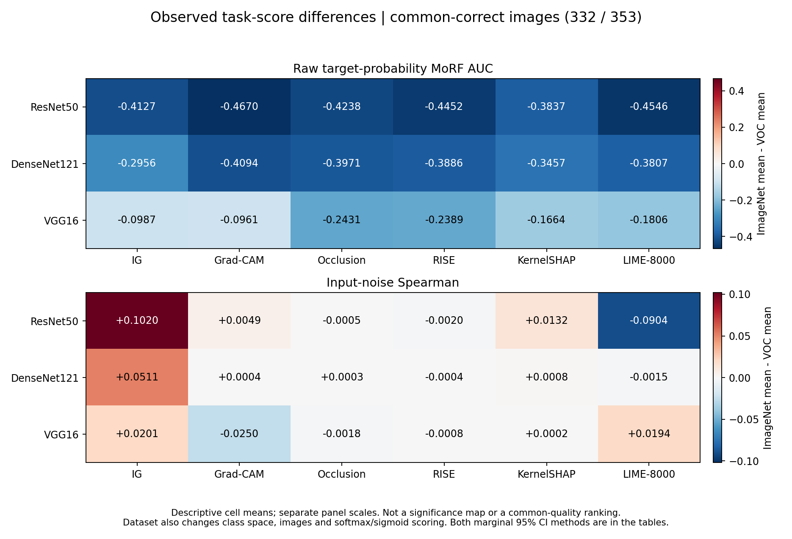
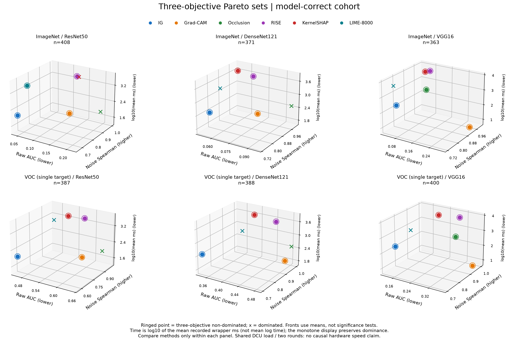
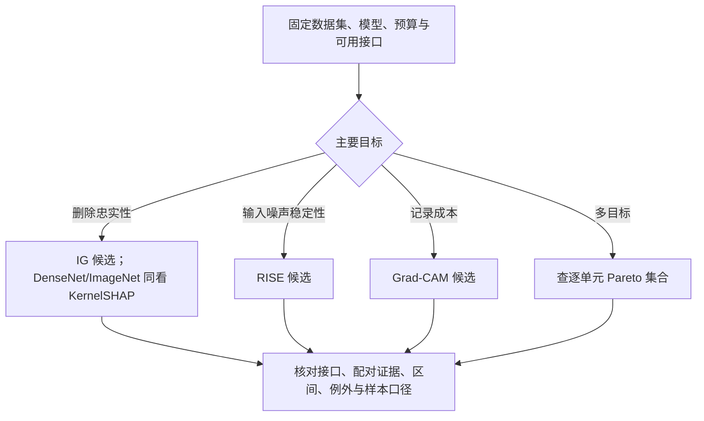

# 归因方法模式发现：什么条件下什么方法更合适

机器学习综合实践 · GO3 · XAI01-04

版本：2026-10-31 合稿 v3。负责人 A；使用同一 DCU 正式批次，已纳入 D 的 10/28 重复测量阶段结果、10/29 数据集×方法×模型混合设计，以及 E 的 12 页 v6 展示入口。A 已对照任务书接收新增统计的计算覆盖与解释口径；C 对新增统计的独立复现、展示验收和全组演练仍待完成。章节责任与固定来源见 [合稿说明](FINAL_REPORT_HANDOFF.md)。

## 摘要

本项目比较六种图像归因方法在不同模型、数据集和评价目标下的表现，研究方法选择中的优势模式与取舍。实验使用 IG、Grad-CAM、Occlusion、RISE、KernelSHAP 和 LIME，覆盖 ResNet50、DenseNet121、VGG16，以及 ImageNet、VOC 两个课程冻结子集，形成 36 个实验单元。每个单元评估相同数据集的 460 张图片，并为每张图片计算五次轻微 RGB 噪声扰动下的解释稳定性。

单模型方法比较采用各模型命中冻结目标的样本，方法间按原图配对；跨模型及因子分析使用三模型共同命中组。结果显示，IG 的平均 raw MoRF AUC 在六个模型/数据集组合中的五个最低，RISE 的平均输入噪声稳定性在六组均最高，Grad-CAM 的记录归因时间在六组均最低。ImageNet/DenseNet121 中，KernelSHAP 的平均 AUC 低于 IG，但配对均值差置信区间跨零，且秩检验方向偏向 IG，因此不能由均值排名断言 KernelSHAP 显著更优。新增重复测量分析支持方法×模型交互；混合三因素分析中，AUC 七项效应均显著，稳定性的数据集主效应未显著，其余六项显著。跨数据集结果只描述冻结评估任务的评分差异，不是统一解释质量尺度。不同方法形成随条件变化的 Pareto 前沿，方法内忠实性与稳定性的相关方向也不一致，支持按目标和条件选择候选方法。以上结论限定于本项目的固定预算、权重、筛选样本及指标定义。

## 1. 问题定义与研究问题

归因图用于描述输入区域对模型目标输出的贡献，但视觉上清晰的热图不一定在忠实性、稳定性和效率上同时占优。本项目不设计新的归因算法，而是建立统一实验与统计流程，回答任务书 XAI01-04 的三个研究问题：

- **RQ1：优势模式。** 在方法、模型、数据集和指标构成的空间中，是否存在某些条件下稳定占优的方法？
- **RQ2：多目标权衡。** 忠实性、稳定性和效率之间如何取舍，哪些方法位于 Pareto 前沿？
- **RQ3：指标冲突。** 指标之间是否存在系统性冲突，高忠实性是否必然伴随低稳定性？

本报告分别陈述逐单元配对、同一数据集内的方法×模型交互，以及包含数据集的混合设计。交互结论来自直接因子检验，不以排名变化或两个单独 p 值的差异代替。任务书四项必做实验与正文、代码和结果的对应见 [任务书覆盖](FINAL_REPORT_HANDOFF.md#2-任务书覆盖)。

## 2. 实验设计

### 2.1 矩阵、数据与样本口径

| 维度 | 实际设置 |
| --- | --- |
| 方法 | IG、Grad-CAM、Occlusion、RISE、KernelSHAP、LIME-8000 |
| 模型 | ResNet50、DenseNet121、VGG16 |
| 数据 | ImageNet、VOC；CHNCXR 不进入主矩阵 |
| 每个数据集 | 500 张冻结图片，其中 40 张 debug、460 张 eval |
| 主体规模 | 6 × 3 × 2 = 36 单元；16,560 个方法/模型/数据集/原图组合 |
| 稳定性 | 每组合五次输入扰动，共 82,800 条重复记录 |
| 表格 | 66,240 行逐图指标、144 行单元汇总；第四项 valid rate 用于质量控制 |

36 个单元复用各数据集的同一批图片，因此 16,560 个组合不是 16,560 张独立图片。主分析的统计单位是原图，五次噪声先在图内汇总，不能扩成五倍独立样本。

数据来自课程共享的 ImageNet/VOC 子集，冻结版本为 `xai01-04-data-v1`。根据[数据来源记录](../data/README.md)，ImageNet 子集来自 ILSVRC2012 val，经前期单目标、目标框面积及预测结果等规则整理，并已缩放到 500×500；VOC 子集来自 VOC2007 trainval，也经过单目标和目标框面积筛选。因此实验结论不能直接外推到完整 ImageNet/VOC 分布。实际入选 ID、类别和 debug/eval 划分以 [metadata](../data/metadata.csv) 及[冻结哈希](../data/DATA_VERSION.json)为准。

| 数据集 | 模型 | 全 eval | 模型命中组：主分析 | 三模型共同命中组：跨模型 |
| --- | --- | ---: | ---: | ---: |
| ImageNet | ResNet50 | 460 | 408 | 332 |
| ImageNet | DenseNet121 | 460 | 371 | 332 |
| ImageNet | VGG16 | 460 | 363 | 332 |
| VOC | ResNet50 | 460 | 387 | 353 |
| VOC | DenseNet121 | 460 | 388 | 353 |
| VOC | VGG16 | 460 | 400 | 353 |

单模型方法比较采用该模型命中组；跨模型比较使用三模型共同命中组；全部 460 张结果作为敏感性分析保留。筛选只依据预测，不按归因分数选择样本。VOC 的“命中”表示冻结单目标是 sigmoid 输出的 argmax，不是多标签 exact match 或 mAP。

### 2.2 模型与预处理

ImageNet 使用 torchvision 预训练的 1000 类模型，具体权重身份由运行清单及 SHA-256 固定。VOC 使用 B 训练的 20 类多标签模型，损失为 BCEWithLogitsLoss，评价输出使用 sigmoid。VOC 训练与验证 manifest 已排除冻结的全部 500 张 debug/eval 图片，训练说明和权重来源见 [VOC 训练记录](B_VOC20_TRAINING.md)与[checkpoint 清单](VOC20_CHECKPOINT_MANIFEST.json)。模型训练验证 mAP 不与本项目的单目标命中数混用。

所有输入转 RGB，统一 `Resize((224,224))` 后使用 ImageNet mean/std 归一化；此几何预处理不同于部分 torchvision 权重默认的 resize/center-crop 流程，不能据当前命中数声称复现官方分类精度。归因类别固定为 metadata 真值。黑色基线指原始 RGB 为零，归一化后为 `-mean/std`，并非归一化张量全零。

B 已按冻结执行链核对：模型工厂返回 logits，`output_activation` 不会给所有归因方法统一追加概率层；推理采用 eval/FP32。VOC 训练、验证清单分别有 4037、474 张，与冻结 500 张互斥。该结论核对的是已交清单，不替代训练现场的数据读取审计。六套权重的完整 SHA-256、VOC 类别顺序、连接键及旧清单 CRLF 字节说明见 [B 模型与指标复核](https://github.com/oioioi-521/GO3-XAI01-04/blob/f224484ea1edab646ee31a1fcaa51c1dac3bef7f/docs/B_M5_MODEL_AND_METRICS.md)。

### 2.3 方法实现与冻结预算

| 方法 | 实际配置 | 归因使用的模型响应 |
| --- | --- | --- |
| IG | Captum；50 步 Gauss-Legendre；内部 batch=10；黑色基线 | 目标 logit |
| Grad-CAM | Captum LayerGradCam；ReLU；双线性上采样 | 目标 logit |
| Occlusion | Captum；32×32 窗口；stride=16；每批 16 个扰动 | 目标 logit |
| RISE | 4000 masks；7×7；保留概率 0.5；batch=32；seed=42 | ImageNet softmax / VOC sigmoid 目标分数 |
| KernelSHAP | Captum；2048 samples；7×7 特征网格；每批 16；seed=42 | 目标 logit |
| LIME | VectorizedLIME；8000 samples；batch=32；quickshift；采样和分割 seed 均为 42 | ImageNet softmax / VOC sigmoid 目标分数 |

Grad-CAM 的目标层分别为 ResNet50 `layer4.2`、DenseNet121 `features.norm5`、VGG16 `features.28`。LIME 使用 cosine 距离、kernel width=0.25、带截距的加权 Ridge（alpha=1），保留全部超像素。六方法都返回 224×224 的 float32 图；IG/Occlusion/KernelSHAP 的有符号结果经空间投影和 min-max 处理，Grad-CAM 保留 ReLU 非负语义，LIME 将有符号超像素系数投影后归一化。图值不能作为跨方法可比的原始贡献量。

这里统一了目标类别、输入和评价流程，但各方法的归因响应、特征粒度及归一化操作不同。它们是本次被比较实现的一部分，不能将观察差异全部归因于算法名称。IG/Grad-CAM 的原理、实现细节及答辩说明见 [A 方法说明](A_METHODS_AND_DEFENSE.md)；六方法原始论文列于文末。参数依据实际执行配置与[前五方法运行记录](DCU_FULL_RUN_20261013.md)、[LIME 正式记录](LIME_DCU_RESULTS_20261013.md)，不能用旧 debug 配置替代。

Occlusion 通过黑基线替换重叠窗口并观察目标 logit 变化；窗口大小与像素级删除评价的粒度不同，块状外观不能直接解释为质量优劣。RISE 以随机掩码下的目标概率加权估计空间重要性，不需要输入梯度；固定 seed 下的高输入噪声稳定性不证明换一组掩码仍相同。KernelSHAP 将 RGB 共享的 7×7 网格视为 49 个特征组，以采样联盟近似局部加性贡献；带符号贡献投影、min-max 后的图不能再直接解释为保持原始贡献和的 Shapley 数值。各方法的结果和答辩入口见 [B/Occlusion](https://github.com/oioioi-521/GO3-XAI01-04/blob/f224484ea1edab646ee31a1fcaa51c1dac3bef7f/docs/B_M5_OCCLUSION_AND_DEFENSE.md)、[C/RISE](https://github.com/oioioi-521/GO3-XAI01-04/blob/507981464a770ee92dc43b00567f9b42f81071f4/docs/C_M5_REPORT_CONTRIBUTION.md)和 [D/KernelSHAP](D_KERNELSHAP_METHODS_AND_DEFENSE.md)。

### 2.4 指标定义

| 指标 | 定义 | 解释方向 |
| --- | --- | --- |
| `faithfulness_morf_auc_raw` | 按归因值从高到低删除像素并替换成黑色基线，在 0、0.05、…、1 共 21 个比例下计算真值目标分数，以梯形法积分 | 越低表示本删除协议下重要区域被移除后目标分数下降得更充分 |
| `stability_spearman` | RGB [0,1] 域加入 sigma=0.005 高斯噪声，裁剪再归一化；固定方法 seed，求原图和扰动图全像素 Spearman；每图五次 score 均值 | 越高表示对该输入噪声更稳定 |
| `efficiency_time_ms` | 一次不计时预热后的单次原图归因 wrapper 实测时间 | 越低越省时；不含独立预测、MoRF、文件 I/O |
| `stability_valid_rate` | 每图五次重复中相关系数可定义的比例 | 质量控制，不是解释正确率 |

raw MoRF 不除以原始目标分数，不能读成准确率下降比例；ImageNet softmax 与 VOC sigmoid 的绝对 AUC 分开解释。计时保留 wrapper 内实际校验/构图开销，不能改称纯反向传播时间。正式稳定性固定方法 seed，因此不衡量重新采样 RISE/KernelSHAP/LIME 时的随机性。

每个删除比例 f 对应 `round(f×224×224)` 个空间位置，三个通道一起替换；并列值的排序与黑色替换也会影响 AUC，常量图的 AUC 不构成定位证据。正式归档未保存 21 点 MoRF 曲线，不能仅从 AUC 还原曲线。LIME 的 60 个分片各自预热，不能将“一次预热”误读为整个矩阵总共一次；wrapper 的校验 forward、构图、拟合、归一化和 CPU 返回包含在其实际计时内。

Grad-CAM 共 28 条退化重复，相关系数留空、score 按协议计零并保留状态。其余方法重复均有效。退化记录没有被删掉后重新优化均值；噪声归因图未按协议存盘，归档支持 trace/种子/聚合复核，但不能仅凭归档独立重算全部噪声图相关系数。

### 2.5 统计方法

现有分析在每个数据集/模型内对六方法做 Friedman 检验，使用 4,999 次图内秩置换计算 p 值并报告 Kendall W。事后比较采用配对 Wilcoxon、秩二列效应和配对 Cohen dz，同时给出符号检验作为敏感性检查。10,000 次按冻结类别分层、以原图为单位的 bootstrap 用于均值和配对均值差的 95% 区间；同次抽样保留六方法及跨模型的配对关系。

每个样本口径的质量成对比较共 180 项、总体检验 12 项，各自作 Holm 校正；计时另成检验族。相关分析在方法/模型/数据集内部进行，Pearson 和 Spearman 的 216 个端点一起校正，作为探索性分析。区间是条件于类别计数和样本口径的边际区间，不是同时区间。完整族定义、统计假设和复现参数见 [D 统计方案](DCU_STATISTICAL_ANALYSIS_20261015.md#2-统计方案与不确定性)。

因子分析使用共同命中组 ImageNet n=332、VOC n=353，全 eval 各 n=460 为敏感性分析，采用以下互补设计：

- **10/28 数据集内重复测量。** 每张图具有 3 模型×6 方法观测；以原图×效应为误差层，检验方法、模型及其交互，使用 Greenhouse–Geisser（GG）自由度修正和偏η²。每个 cohort 的两质量指标×两数据集×三效应共 12 项作 Holm。方法对优势在两个模型间的变化另作直接差中差（DID），不从全局交互推断任一局部对比显著。
- **10/29 混合三因素。** 数据集为图像间因子，方法/模型为图像内因子，subject=(dataset,image_id) 嵌套于数据集；两数据集不按同名 ID 配对。检验数据集、方法、模型三个主效应、三个二阶交互和三阶交互。图像内主效应采用两数据集等权边际对比，不按 332/353 加权；名义 ANOVA 保留各效应的 subject-within-dataset 误差层和 GG 修正。
- **假设与敏感性。** 名义 ANOVA 依赖同质协方差等近似；另给各数据集分别估计协方差的 Wald-type statistic（WTS），用 9,999 次零假设 Gaussian parametric bootstrap 校准，保留独立原图、有限四阶矩及满秩对比协方差假设。每个 cohort 内，名义 ANOVA 与 WTS 各自对 14 项质量假设作 Holm；逐图 log1p(wrapper ms) 的七项另成探索性族。bootstrap 生成的零假设样本不混入正式观测。

混合设计共有两 cohort×三指标×七效应=42 项结果，另附 108 个跨任务单元均值差；区间使用 10,000 次原图 bootstrap，分别保留类别分层和 IID 抽样。它们是边际 95% CI，不因全局 Holm 获得同时覆盖。ImageNet 共同命中组的 194 类中有 111 个单例类别，分层区间条件于固定类别计数，IID 区间用于展示类别构成变化的敏感性。

任务书实验 4 所要求的三个因子及其交互均已有实际 ANOVA 与效应量，A 已核对并接收为本报告的计算覆盖，不再以省略数据集因子的替代方案处理。跨数据集的原始评分同时受 softmax/sigmoid、类别空间、图片总体和预处理影响，不能据数据集效应解释因果或潜在质量高低。设计、完整 F/自由度/效应量与脚本见 [阶段报告](D_M5_REPEATED_MEASURES_20261028.md)、[混合设计报告](D_M5_MIXED_FACTORIAL_20261029.md)；A 的核对范围见 [10/31 接收记录](A_M5_REVIEW_20261031.md)。C 独立复现与课程最终验收另行记录。

## 3. RQ1：哪些条件下存在优势模式

### 3.1 单模型方法比较与例外

在模型命中组中，IG 的平均 raw MoRF AUC 六组有五组最低，RISE 的平均输入噪声稳定性六组均最高，Grad-CAM 的记录时间六组均最低。这些是不同评价目标下的描述性结论，不构成一个综合总排名。六组的两项质量指标总体检验均经 Holm 校正后 p=0.0024，说明方法间存在可检测差异，但总体检验不能直接确定每一对方法的优劣。

图 1：各模型命中组；误差线为均值的边际 95% CI，不是样本标准差。图中不同模型的命中组不是同一批原图。完整数值见 [D 主分析表](DCU_STATISTICAL_ANALYSIS_20261015.md#3-主分析测量值)。

以 A 负责的两种方法为例，六组中 IG 的平均 AUC 都低于 Grad-CAM；配对 AUC 差的边际 95% CI 均支持该方向，Wilcoxon 经质量族 Holm 校正后也均显著。Grad-CAM 的平均噪声稳定性六组均更高，其配对证据同样支持这一方向。由此可以回答一个具体选择问题：在当前协议下，这两种方法分别更适合作为偏忠实性和偏效率/稳定性的候选。详细六组证据见 [A 的配对表](A_METHODS_AND_DEFENSE.md#2-正式结果与配对证据)。

最重要的例外是 ImageNet/DenseNet121：KernelSHAP 平均 AUC=0.05013，IG=0.05325；按“KernelSHAP−IG”定义的 IG 均值优势为 −0.00313，95% CI 为 [−0.00842, 0.00207]，跨越零。与此同时，IG 的秩二列效应为 +0.312，Wilcoxon Holm p=5.16e−6。均值差与秩检验回答不同问题，因此既不能按均值点估计宣布 KernelSHAP 显著更优，也不能把该秩检验解释成 IG 均值更低。

D 于 10/27 从冻结 CSV 重新计算三种样本口径的配对描述量、Wilcoxon、各 180 项质量族 Holm 校正及原 seed 的 10,000 次分层 bootstrap，均与原结果一致。主分析 n=371，IG 的 AUC 在 259 图较低、112 图较高；共同命中组 n=332 与全 eval n=460 的均值差区间也均跨零、秩方向偏 IG。完整表见 [D 独立复算确认](D_M5_STATISTICAL_CONFIRMATION_20261027.md)。此复算确认了既有例外，不是方法 × 模型交互结果。

共同命中组的跨模型比较保留同图配对，但模型输出置信度尺度也随权重与模型变化，raw MoRF 不是归一化架构质量。下面的因子分析检验优势结构是否变化，不改变这个解释边界。

### 3.2 同一数据集内的方法×模型交互

共同命中组的四项质量交互均通过 GG 与 Holm 校正，偏η²如下；完整主效应及全 eval 敏感性见 [阶段统计 JSON](../analysis/dcu_20261028/repeated_measures.json)。

| 数据集 | 指标 | F | GG-Holm p | 偏η² |
| --- | --- | ---: | ---: | ---: |
| ImageNet | raw AUC | 270.811 | 2.85e-128 | 0.4500 |
| ImageNet | 噪声 Spearman | 181.224 | 5.13e-111 | 0.3538 |
| VOC | raw AUC | 49.775 | 3.17e-53 | 0.1239 |
| VOC | 噪声 Spearman | 561.891 | <1e-250 | 0.6148 |

图 2：同一数据集内各模型使用同一批共同命中图片；误差线为类别分层原图 bootstrap 的边际 95% CI，不是 SD。折线展示均值结构，GG-Holm 检验才提供交互证据；不同面板的 raw AUC 不作统一质量比较。

交互显著不表示每个方法对在每个模型对之间都显著。例如 VOC/AUC 中，定义 IG 相对 KernelSHAP 的优势为 KS AUC−IG AUC，ResNet50 优势减 DenseNet121 优势的 DID=+0.014942。类别分层 95% CI=[+0.003176,+0.026916]，IID 原图 CI=[−0.006141,+0.035535]，配对秩 Holm p=0.8374。该具体比较对区间口径敏感，不能因全局交互显著而宣称其稳健显著；均值区间与秩检验针对的统计量也不同。[直接差中差表](../analysis/dcu_20261028/direct_did_tables.md)保留全部 360 项比较。

### 3.3 数据集×方法×模型的混合设计

共同命中主分析的两质量指标结果如下。偏η²来自名义 ANOVA 的 SS_H/(SS_H+SS_error)，不是因果解释方差；WTS 的 p 与名义 GG-ANOVA 分列，不混为同一个检验。

| 效应 | AUC GG-Holm p | AUC 偏η² | AUC WTS-Holm p | 稳定性 GG-Holm p | 稳定性偏η² | 稳定性 WTS-Holm p |
| --- | ---: | ---: | ---: | ---: | ---: | ---: |
| 数据集 | 2.5e-191 | 0.7224 | 0.0014 | 0.121 | 0.0035 | 0.115 |
| 方法 | 3.56e-225 | 0.3772 | 0.0014 | <1e-250 | 0.8018 | 0.0014 |
| 模型 | 6.11e-226 | 0.5737 | 0.0014 | 2.11e-243 | 0.5828 | 0.0014 |
| 数据集×方法 | 2.85e-28 | 0.0593 | 0.0014 | 2.02e-10 | 0.0386 | 0.0014 |
| 数据集×模型 | 1.64e-175 | 0.4840 | 0.0014 | 0.00762 | 0.0084 | 0.0014 |
| 方法×模型 | 4.07e-223 | 0.2599 | 0.0014 | <1e-250 | 0.4570 | 0.0014 |
| 数据集×方法×模型 | 2.93e-35 | 0.0492 | 0.0014 | 7.39e-77 | 0.1330 | 0.0014 |

AUC 七项效应均显著；稳定性的数据集主效应未显著，其余六项显著。三重交互说明两个冻结任务的方法/模型对比结构存在差异，并不证明每个局部方法对均显著，也不把未显著主效应解释为两任务等效。全 eval 的显著/未显著模式相同，稳定性数据集主效应名义 p=0.084957、WTS p=0.0842。完整 42 项结果和 108 个单元差见 [混合设计 JSON](../analysis/dcu_20261029/mixed_factorial.json)与[结果表](../analysis/dcu_20261029/mixed_factorial_tables.md)。

WTS 原始 p 的最小分辨率为 1/10,000；上表多数质量 Holm p=0.0014 是有限抽样下界，不是精确的极小 p，更不是 p=0。名义 p 小于 1e-250 的项只写阈值，避免把浮点截断当成额外精度。逐图 log1p(ms) 的七项效应在两 cohort 均显著，但共享 DCU 的负载、方法实现/预算及 LIME 运行轮次仍混杂，不能写硬件或算法的因果速度优势。

图 3：逐单元 ImageNet 均值−VOC 均值，颜色只表示观察评分差，不是显著性标记。数据集同时改变输出激活、类别空间和图片总体，因此不能据上图负 AUC 差宣称 ImageNet 解释更好；稳定性中相反方向的单元差也可能在数据集边际均值中抵消。

RQ1 的回答由此补全：固定任务与指标下存在优势模式和局部例外，方法表现与模型存在交互，两个冻结任务的对比结构也不同。方法选择仍回到同数据集、同目标下的质量证据与成本边界，不由全局交互生成一个跨场景冠军。

## 4. RQ2：忠实性、稳定性与效率如何取舍

每个模型/数据集内部，以平均 AUC 最小、稳定性最大构成双目标质量前沿，再加入本批次记录时间最小构成三目标前沿。若一个候选在全部目标上不差、且至少一个更好，则支配另一个候选。前沿是这些点估计下的非支配集合，不表示每个差异已通过显著性检验。

| 数据集 | 模型 | 质量双目标前沿 | 加入记录时间的三目标前沿 |
| --- | --- | --- | --- |
| ImageNet | ResNet50 | IG、Grad-CAM、RISE、LIME | IG、Grad-CAM、RISE、LIME |
| ImageNet | DenseNet121 | RISE、KernelSHAP | IG、Grad-CAM、RISE、KernelSHAP |
| ImageNet | VGG16 | IG、RISE、KernelSHAP | IG、Grad-CAM、Occlusion、RISE、KernelSHAP |
| VOC | ResNet50 | IG、Grad-CAM、RISE、KernelSHAP | IG、Grad-CAM、RISE、KernelSHAP |
| VOC | DenseNet121 | IG、RISE、KernelSHAP | IG、Grad-CAM、RISE、KernelSHAP |
| VOC | VGG16 | IG、RISE、KernelSHAP | IG、Grad-CAM、Occlusion、RISE、KernelSHAP |

图 4：实心点表示质量前沿，叉号表示质量上被支配的候选，外圈表示加入记录时间后的三目标前沿。记录时间来自两轮共享 DCU 运行，因此三目标前沿仅描述该批次观测，不是隔离硬件和负载后的普适效率排名。

图 5：任务书实验 2 的三维展示，每个面板固定数据集/模型并使用模型命中组。圈点为三目标非支配方法，叉号为被支配方法；点来自冻结均值，未拟合不存在的连续前沿曲面。纵深时间轴使用 log10(平均记录 ms)，仅为展示的单调变换，不改变支配关系；它不同于因子分析中先逐图 log1p 再求均值的时间变量。图 4 的二维质量投影便于读质量取舍，图 5 显示记录成本这一第三维。[绘图程序](../analysis/plot_final_pareto_3d.py)重新核对六组 36 个前沿标记与原统计一致。

主分析与三模型共同命中组的质量前沿相同；改用全部 460 张时，ImageNet/DenseNet121 增加 Grad-CAM，VOC/ResNet50 移除 Grad-CAM。样本口径会影响候选集合，应同时披露敏感性结果。RQ2 的回答是：当前数据存在多种有效取舍，质量前沿每组包含 2–4 种方法；引入记录成本后候选集合可能扩大，不能只按一个质量均值淘汰其他方法。

## 5. RQ3：高忠实性是否必然伴随低稳定性

方法间的取舍与方法内部的图片差异需要分开分析。IG 与 Grad-CAM 的配对比较确实表现出忠实性和噪声稳定性的取舍，但不能据此推断所有方法、所有图片都服从同一关系。

图 6：在固定方法/模型/数据集内计算相关，避免把不同模型、数据集的 36 个均值混成一个总体。

例如，ImageNet/DenseNet121 的 LIME 中，AUC 与稳定性的 Spearman rho=+0.383，Holm p=4.49e−12；VOC/VGG16 的 KernelSHAP 中，rho=−0.392，Holm p=8.89e−14。由于 AUC 越低越好，正相关表示较差忠实性与较高稳定性伴随出现；负相关表示较低 AUC 与较高稳定性可以同时出现。

因此现有结果不支持“高忠实性必然低稳定性”的统一命题。相关方向依赖方法、模型和数据集，相关也不能证明提高一个指标会导致另一个指标变化。三指标的完整探索性相关与校正结果保留在 [statistics.json](../analysis/dcu_20261015/statistics.json) 的 `correlations` 中；正文优先解释两项质量指标，计时关系受共享负载限制。

## 6. 方法选择指南

先固定数据集、模型和可用接口，再明确主要目标；在对应单元内查表，而不是跨数据集直接比较 raw AUC。以下是当前观察支持的候选规则，不是经过外部验证的自动推荐模型。

D 已对六条规则逐项核对数值及限制，见[复核记录](D_M5_STATISTICAL_CONFIRMATION_20261027.md#方法选择指南的复核)。A 本轮将 10/28、10/29 因子结果与规则逐项对照：交互支持按任务/模型查表，但不覆盖局部均值/秩例外，也不支持跨数据集原始评分选冠军，因此保留以下规则及 LIME 证据边界。最终展示中的图注一致性仍由 A/D/E 共同核对。

| 条件或目标 | 候选建议 | 现有依据 | 例外与边界 |
| --- | --- | --- | --- |
| 优先本项目删除协议下的忠实性，具备梯度访问 | 将 IG 作为首个比较候选 | 主分析六组中五组平均 AUC 最低；相对 Grad-CAM 六组配对 AUC 证据支持 IG | ImageNet/DenseNet121 需并列考察 KernelSHAP；黑基线、50 步及响应定义均固定 |
| 优先轻微 RGB 输入噪声稳定性 | 将 RISE 作为候选 | 主分析六组平均稳定性最高 | 固定掩码 seed；不等于重采样稳定性，也不保证忠实性最佳 |
| 优先较低记录成本，且可取得内部特征层和梯度 | 将 Grad-CAM 作为候选 | 本批次六组 wrapper 时间均最低；相对 IG 平均噪声稳定性更高 | 相对 IG 的 AUC 更高；计时结论仅限本批次，目标层与空间分辨率影响解释 |
| 同时重视忠实性和稳定性 | 使用第 4 节逐单元质量前沿，再检查配对差异和区间 | 六组质量前沿包含 2–4 种方法；没有质量双目标的单一通用冠军 | 前沿点之间并非均有显著差异；小效应与样本口径敏感性须保留 |
| 只能查询输出分数 | 在可用的 RISE、LIME、Occlusion、KernelSHAP 实现中按对应指标筛选 | 这些实现无需输入梯度；LIME 在 ImageNet/ResNet50 位于当前质量前沿 | 当前响应包含 logit 与概率的区别，部署接口必须支持实际使用的响应，不能直接互换 |
| 希望采用 LIME-8000 | 查已有 debug 拟合/采样记录及对应单元前沿；不推定未保存的正式逐图拟合质量 | 当前只在 ImageNet/ResNet50 的质量前沿中出现；相对 IG 六组平均 AUC 均更高 | 正式 eval 未保存逐图 weighted R²；8000 是固定预算，不是收敛证明 |

上述流程图只整理本项目规则，没有训练或验证预测型决策树；不将其自动计为选做“方法选择决策树”实验已经完成。

## 7. 工程实现与计算成本

实验通过冻结数据、配置驱动、逐图续跑、独立结果目录和身份校验控制组合规模。正式参数先经 debug 检查，eval 阶段保留每个单元的配置、预测、float32 基础归因图、稳定性 trace 和结果汇总。方法负责人对参数与结果负责，运行设备可以共享。

前五方法以单元为任务在八卡上并行；LIME 的六个逻辑单元进一步拆成 60 个互不重叠的 46 图分片，最多八个并发 worker。LIME 向量化使用设备上的超像素查表构造扰动输入，保留采样、分割、随机数、距离核和 Ridge 规则。历史执行记录中，720 张 debug map 与 weighted R² 和原实现逐值相同；这支持该批等价检查的结论，不表示提高了解释质量。

| 实测项目 | 结果 | 分母与适用范围 |
| --- | --- | --- |
| 前五方法 30 单元正式墙钟 | 4:21:06.2 | 包括加载、预热、原图/噪声归因、MoRF、保存与运行内校验 |
| 优化 LIME 六单元正式墙钟 | 3:52:06.7 | 60 分片、8000 samples/batch32；不含前置回归和后续下载独立审计 |
| 两轮正式墙钟相加 | 8:13:12.9 | 两次实际运行之和，不是六方法同一队列的一次实测 |
| LIME 8000 原版/向量化配对测速 | 4.36–7.36 倍 | 六组合各三张 debug、相同 batch32；没有全量原版重跑对照 |

共享机器负载、CPU/软件栈和并发任务组合会影响耗时；旧 RTX 2080 Ti 与新 DCU 结果不混成同机排名，也不由八卡并发墙钟推导单卡硬件加速比。实际运行证据见[前五方法正式报告](DCU_FULL_RESULTS_20261013.md)、[LIME 结果](LIME_DCU_RESULTS_20261013.md)和[预算与优化审阅](LIME_DCU_BUDGET_REVIEW_20261013.md)。

### 7.1 独立分析复现与数据交付

C 已在不安装 torch 的独立 Python 3.12 CPU 环境从冻结轻量 ZIP 重建七张派生表、四图和报告。其 [复现回执](https://github.com/oioioi-521/GO3-XAI01-04/blob/507981464a770ee92dc43b00567f9b42f81071f4/analysis/c_m5_reproduction_receipt.json)记录 1,872 条派生记录逐值一致、四幅 PNG 逐字节一致，报告文本按换行规范化后全文一致；这复现的是表格分析，不包括 GPU 归因和未保存的噪声归因图。A 本轮读取并合稿该回执，没有将它记作 A 又执行了一遍完整统计。

C 的 [PR #24](https://github.com/oioioi-521/GO3-XAI01-04/pull/24)已由 A 在 `eb275ed535a1ba660608a9606fd3847f83460405` 修复两处验收逻辑：数据版本按原字节 hash，四张图的字节比较全部通过才可得到总 `passed`。6 项针对性回归通过，包括四图齐全但一图字节不匹配时返回失败；[修复回执](https://github.com/oioioi-521/GO3-XAI01-04/blob/eb275ed535a1ba660608a9606fd3847f83460405/analysis/a_pr24_gate_review_20261031.json)与 C 原有完整复现回执分别记录。此修复没有重跑 C 的完整统计；新增统计独立复现、最终集成、独立 Demo 和 main 发布仍待完成。

全组后续分析统一使用 10/26 全量包中原样保存的 DCU 数据；三卷 `dcu_team_complete_20261026.7z.001–003` 均小于 1 GB，含 16,560 组正式基础 NPY/PNG/sidecar、六套权重、冻结原图、配置、trace、预测与逐文件 SHA-256。包内的 10/14 轻量 ZIP 身份未变。它是数据与代码快照，10/27 以后的文字/分析更新以固定 Git 提交为准；不混入旧 GPU 批次，也不把新文档误称为新实验。

## 8. 真实案例与局限

### 8.1 选择规则和来源

B 从 VOC/ResNet50 的 387 张模型命中组中，按可复现的名次/置信度规则选出 215、3803、7612，与 E 的既有候选一致；另选 VOC/VGG16/298 作为常量 Grad-CAM 异常例。这是从已得结果选择的解释性案例，不是随机抽样或预注册检验。B/E 已确认前三例及并列规则，E v6 和固定 Demo 使用这三例；298 留在报告异常分析，本版不加入固定 Demo。

| image_id | 模型 / 真值 target | 预测置信度 | 选择依据与作用 |
| --- | --- | ---: | --- |
| 215 | ResNet50 / cat (7) | 0.966232 | 六方法四指标的名次画像与池内中位画像 L1 距离为 0；并列先取高置信度、再按数值 ID。展示典型取舍，不声称总体抽样代表性 |
| 3803 | ResNet50 / bird (2) | 0.868719 | AUC 与噪声稳定性的方法名次平方差和为 70，与 4675 并列，取较小 ID；展示指标排序冲突 |
| 7612 | ResNet50 / dog (11) | 0.539305 | 387 张命中组中置信度最低；仍然预测命中，不能写成误分类 |
| 298 | VGG16 / person (14) | 0.989805 | 模型命中且共同命中；Grad-CAM 五次相关退化，展示预测正确与解释退化并存 |

前三例 ResNet50 checkpoint SHA-256 为 `1e54867cf18ed02383ba329c944a9143871fc37fe268bec6e769a8d364ae134f`，第四例 VGG16 为 `61640717641bfc1e9ae5d6172de667ce45755e6f046f458c848f70cb4a6c9d58`。完整配置、target、预测、cohort 和 map 来源见 [B 的 24 行清单](https://github.com/oioioi-521/GO3-XAI01-04/blob/f224484ea1edab646ee31a1fcaa51c1dac3bef7f/analysis/b_m5_20261026/case_candidates.csv)。A 于 10/27 从全量包核验这 24 组 NPY、PNG、sidecar、配置、协议、稳定性配置与原图 hash，确认 NPY 均为有限的 224×224 float32，且 E 的 18 行指标/预览与同一来源一致。此为 A 的补充核验，不回填为 B 已收到 NPY；详见 [A 复核记录](A_M5_REVIEW_20261027.md)。

### 8.2 同图六方法的定量取舍

每格为 **raw MoRF AUC / 输入噪声 Spearman score**；AUC 越低越好，score 越高越好。只能在同一列的同图、同模型、同目标内比较，不能把不同图片的 raw AUC 当作相同起点。

| 方法 | 215 / ResNet50 | 3803 / ResNet50 | 7612 / ResNet50 | 298 / VGG16 |
| --- | --- | --- | --- | --- |
| IG | 0.45038 / 0.60048 | 0.61097 / 0.72360 | 0.36502 / 0.47697 | 0.12478 / 0.93092 |
| Grad-CAM | 0.61039 / 0.99793 | 0.80591 / 0.99292 | 0.26031 / 0.96494 | 0.67589 / 0.00000* |
| Occlusion | 0.86079 / 0.84553 | 0.78758 / 0.90902 | 0.47232 / 0.84975 | 0.13020 / 0.99732 |
| RISE | 0.61838 / 0.99989 | 0.81341 / 0.99962 | 0.24250 / 0.99884 | 0.42626 / 0.99978 |
| KernelSHAP | 0.55935 / 0.99176 | 0.80117 / 0.98200 | 0.22972 / 0.96476 | 0.08277 / 0.99871 |
| LIME | 0.56340 / 0.72490 | 0.76855 / 0.76248 | 0.20177 / 0.82359 | 0.27571 / 0.84072 |

*298 的 Grad-CAM 五次相关均未定义，按冻结规则 score=0、valid_rate=0；不是有效 Spearman 系数恰好为零。其余 23 项 valid_rate=1。A 核验该基础 NPY 全零，PNG 为黑图；五条 trace 为三次 `both_constant`、两次 `reference_constant`，未独立重算未保存的噪声图。

215 中，IG 相对 Grad-CAM 的 AUC 更低而噪声稳定性更低，呈现与总体比较相容的取舍。3803 更清楚地显示两个指标的排序冲突：IG 的 AUC 最低、稳定性最低，RISE 的稳定性最高、AUC 最高。它们回答不同的评价问题，视觉平滑不能替代忠实性证据。

7612 的 LIME AUC 最低，虽然 LIME 在该模型/数据集的总体平均 AUC 不优于 IG；总体排序不要求每张图片都同序。这张低置信图片仍被正确命中，没有证据将它称作 LIME 失败。298 则展示另一类异常：高预测置信度不能保证解释非退化；常量 Grad-CAM 的 AUC 不证明定位正确。目标层、梯度、ReLU 和特征粒度可能影响结果，但本轮未作控制变量实验，不宣称已定位退化机制。

正式 eval 未保存逐图 LIME weighted R²，固定方法 seed 的输入噪声测试也不是采样方差测试。因此不为这四例添加“局部拟合失败”或“采样不收敛”的结论。已有 debug 拟合/预算记录仅用于说明该记录范围内的限制。

E 的 [12 页 v6 PPT/PDF 与固定 Demo](https://github.com/oioioi-521/GO3-XAI01-04/tree/755edca74c88ca74ce6384baa75f31bc396f7ad3/deliverables/e_m5)已进入 [PR #26](https://github.com/oioioi-521/GO3-XAI01-04/pull/26)，包含前三例的 18 张正式灰度预览及来源记录；第 4 页使用本报告图 2 的同一原图，展示 10/28 阶段交互与 VOC 局部例外。灰度强度不作跨方法原始贡献比较。v6 第 12 页“三因素统计未完成”反映制作时状态，本报告已接收 10/29 结果，E 后续需同步该页及交付说明。克隆后的 Demo 原图需从获准的全量包恢复，独立设备演练仍待 C/E 记录；内容接收不代替展示签收。

### 8.3 外推范围与剩余工作

当前结论的局限包括：课程子集的选择偏差与类别不均衡；每个架构只使用一套冻结权重；方法预算、特征粒度、响应量和归一化不完全相同；黑色删除的分布变化；固定方法 seed 的单一输入噪声稳定性；主分析条件于模型命中组；均值区间不覆盖训练或新分布不确定性；计时来自共享机器。这些因素限定了可外推的范围，不能靠补充更多显著性星号消除。

最终合稿仍需：C 集成所有新成果并独立复现新增统计；E 同步三因素结论与版本说明、完成展示定稿和独立演练；E→A 环形复核及全组计时复核。D 的因子结果、A 的任务书口径接收、B/E 的三例选择，以及 B 的措辞与 C 两处验收逻辑修复均已完成，不再保留为等待首轮交付。各项状态集中记录在[合稿表](FINAL_REPORT_HANDOFF.md)。

## 9. 结论

已完成的 36 单元实验、配对统计和因子分析表明，归因方法的选择依赖评价目标和具体条件。当前预算下，IG 常提供更低的删除 AUC，RISE 提供更高的输入噪声稳定性，Grad-CAM 在本批次记录成本较低；不同方法的优势通过多个 Pareto 候选共存。方法×模型及三重交互支持对比结构随条件变化，但稳定性的数据集主效应未显著，具体方法对的区间与秩例外仍须保留。方法内相关的正负并存说明忠实性与稳定性没有统一的必然冲突关系。四个真实案例进一步说明个体排序、总体均值和解释退化不能混为一谈。报告已覆盖四项必做实验的结果与限制，并连接 E v6；新增统计独立复现、最终展示验收与全组演练仍属交付收尾。

## 参考文献与证据入口

1. Sundararajan, M., Taly, A., Yan, Q. (2017). [Axiomatic Attribution for Deep Networks](https://proceedings.mlr.press/v70/sundararajan17a.html). ICML.
2. Selvaraju, R. R., et al. (2017). [Grad-CAM: Visual Explanations from Deep Networks via Gradient-based Localization](https://arxiv.org/abs/1610.02391). ICCV.
3. Zeiler, M. D., Fergus, R. (2014). [Visualizing and Understanding Convolutional Networks](https://arxiv.org/abs/1311.2901). ECCV（预印本 2013）；遮挡分析背景。
4. Petsiuk, V., Das, A., Saenko, K. (2018). [RISE: Randomized Input Sampling for Explanation of Black-box Models](https://arxiv.org/abs/1806.07421). BMVC.
5. Lundberg, S. M., Lee, S.-I. (2017). [A Unified Approach to Interpreting Model Predictions](https://proceedings.neurips.cc/paper/2017/hash/8a20a8621978632d76c43dfd28b67767-Abstract.html). NeurIPS.
6. Ribeiro, M. T., Singh, S., Guestrin, C. (2016). [“Why Should I Trust You?”: Explaining the Predictions of Any Classifier](https://arxiv.org/abs/1602.04938). KDD.
7. StataCorp. [Repeated-measures ANOVA examples](https://www.stata.com/support/faqs/statistics/repeated-measures-anova/). 一个图像间因子和两个图像内因子的误差层及公开数值对照。
8. Friedrich, S., Konietschke, F., Pauly, M. (2019). [Resampling-Based Analysis of Multivariate Data and Repeated Measures Designs with the R Package MANOVA.RM](https://journal.r-project.org/articles/RJ-2019-051/). The R Journal；异方差 WTS 与零假设参数 bootstrap 的依据，本项目为 Python 实现。

方法原理分别对应 §2.3 的六方法；具体实现以仓库代码与冻结执行配置为准。本项目数值来自 [10/15 统计 JSON](../analysis/dcu_20261015/statistics.json)、[配对表](../analysis/dcu_20261015/paired_quality_tables.md)、[10/28 重复测量 JSON](../analysis/dcu_20261028/repeated_measures.json)、[10/29 混合设计 JSON](../analysis/dcu_20261029/mixed_factorial.json)和正式运行报告；文献的公开数值只用于软件对照，没有混入课程观测。

分析输入 ZIP SHA-256：`14b6ea625f41e6c7c0587fd0073fc70e2064df0260107dca042335c6fc2303dc`。10/15 统计 JSON 的 LF 规范化 SHA-256：`6c098e27cc36e98c46172845ca5d5c5f7477cb0df29b23325dbe27d7ecbbe473`。10/31 合稿来源：D `272ca25fccb30cc1511bbd3684f2c99397e66e93`；B `f224484ea1edab646ee31a1fcaa51c1dac3bef7f`；C 原复现 `507981464a770ee92dc43b00567f9b42f81071f4`、验收修复 `eb275ed535a1ba660608a9606fd3847f83460405`；E `755edca74c88ca74ce6384baa75f31bc396f7ad3`。原始实验及 10/15、10/28、10/29 的已发布统计未改写；新接收与验证记录独立保存。
