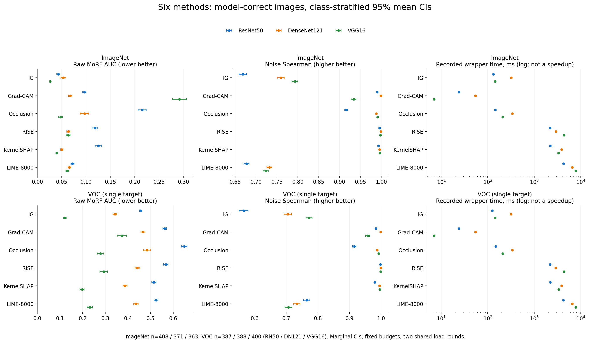
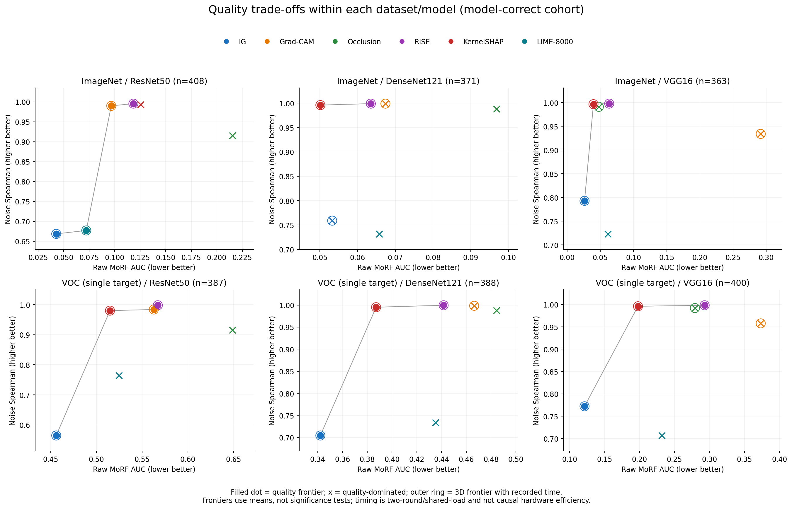
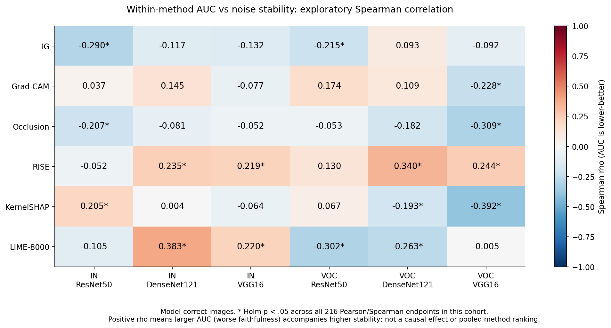
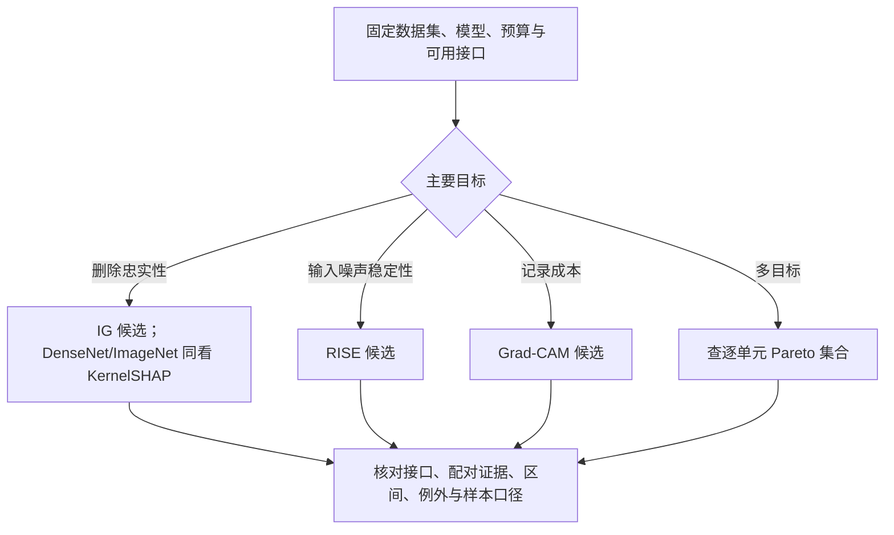

# 归因方法模式发现：什么条件下什么方法更合适

机器学习综合实践 · GO3 · XAI01-04

版本：2026-10-26 报告初稿。负责人 A；基于已验收的 DCU 正式批次和 D 于 2026-10-15 交付的统计。主效应/交互效应补充、真实案例、最终独立复现和答辩材料尚待合稿，不能将本版标记为最终验收完成。章节责任与证据对应关系见 [合稿说明](FINAL_REPORT_HANDOFF.md)。

## 摘要

本项目比较六种图像归因方法在不同模型、数据集和评价目标下的表现，研究方法选择中的优势模式与取舍。实验使用 IG、Grad-CAM、Occlusion、RISE、KernelSHAP 和 LIME，覆盖 ResNet50、DenseNet121、VGG16，以及 ImageNet、VOC 两个课程冻结子集，形成 36 个实验单元。每个单元评估相同数据集的 460 张图片，并为每张图片计算五次轻微 RGB 噪声扰动下的解释稳定性。

主分析采用各模型命中冻结目标的样本，方法间按原图配对；跨模型比较使用三模型共同命中组。结果显示，IG 的平均 raw MoRF AUC 在六个模型/数据集组合中的五个最低，RISE 的平均输入噪声稳定性在六组均最高，Grad-CAM 的记录归因时间在六组均最低。ImageNet/DenseNet121 中，KernelSHAP 的平均 AUC 低于 IG，但配对均值差置信区间跨零，且秩检验方向偏向 IG，因此不能由均值排名断言 KernelSHAP 显著更优。不同方法形成随条件变化的 Pareto 前沿；方法内忠实性与稳定性的相关方向也不一致。当前证据支持按目标和条件选择候选方法，而非给出适用于全部场景的统一冠军。以上结论限定于本项目的固定预算、模型权重、筛选样本及指标定义；因子交互效应尚待补充。

## 1. 问题定义与研究问题

归因图用于描述输入区域对模型目标输出的贡献，但视觉上清晰的热图不一定在忠实性、稳定性和效率上同时占优。本项目不设计新的归因算法，而是建立统一实验与统计流程，回答任务书 XAI01-04 的三个研究问题：

- **RQ1：优势模式。** 在方法、模型、数据集和指标构成的空间中，是否存在某些条件下稳定占优的方法？
- **RQ2：多目标权衡。** 忠实性、稳定性和效率之间如何取舍，哪些方法位于 Pareto 前沿？
- **RQ3：指标冲突。** 指标之间是否存在系统性冲突，高忠实性是否必然伴随低稳定性？

本报告将逐单元比较与跨模型观察分别陈述。方法排名随模型变化本身不等于统计交互效应已经成立，现有配对结果也不替代任务书要求的因子分析。

## 2. 实验设计

### 2.1 矩阵、数据与样本口径

| 维度 | 实际设置 |
| --- | --- |
| 方法 | IG、Grad-CAM、Occlusion、RISE、KernelSHAP、LIME-8000 |
| 模型 | ResNet50、DenseNet121、VGG16 |
| 数据 | ImageNet、VOC；CHNCXR 不进入主矩阵 |
| 每个数据集 | 500 张冻结图片，其中 40 张 debug、460 张 eval |
| 主体规模 | 6 × 3 × 2 = 36 单元；16,560 个方法/模型/数据集/原图组合 |
| 稳定性 | 每组合五次输入扰动，共 82,800 条重复记录 |
| 表格 | 66,240 行逐图指标、144 行单元汇总；第四项 valid rate 用于质量控制 |

36 个单元复用各数据集的同一批图片，因此 16,560 个组合不是 16,560 张独立图片。主分析的统计单位是原图，五次噪声先在图内汇总，不能扩成五倍独立样本。

数据来自课程共享的 ImageNet/VOC 子集，冻结版本为 `xai01-04-data-v1`。根据[数据来源记录](../data/README.md)，ImageNet 子集来自 ILSVRC2012 val，经前期单目标、目标框面积及预测结果等规则整理，并已缩放到 500×500；VOC 子集来自 VOC2007 trainval，也经过单目标和目标框面积筛选。因此实验结论不能直接外推到完整 ImageNet/VOC 分布。实际入选 ID、类别和 debug/eval 划分以 [metadata](../data/metadata.csv) 及[冻结哈希](../data/DATA_VERSION.json)为准。

| 数据集 | 模型 | 全 eval | 模型命中组：主分析 | 三模型共同命中组：跨模型 |
| --- | --- | ---: | ---: | ---: |
| ImageNet | ResNet50 | 460 | 408 | 332 |
| ImageNet | DenseNet121 | 460 | 371 | 332 |
| ImageNet | VGG16 | 460 | 363 | 332 |
| VOC | ResNet50 | 460 | 387 | 353 |
| VOC | DenseNet121 | 460 | 388 | 353 |
| VOC | VGG16 | 460 | 400 | 353 |

单模型方法比较采用该模型命中组；跨模型比较使用三模型共同命中组；全部 460 张结果作为敏感性分析保留。筛选只依据预测，不按归因分数选择样本。VOC 的“命中”表示冻结单目标是 sigmoid 输出的 argmax，不是多标签 exact match 或 mAP。

### 2.2 模型与预处理

ImageNet 使用 torchvision 预训练的 1000 类模型，具体权重身份由运行清单及 SHA-256 固定。VOC 使用 B 训练的 20 类多标签模型，损失为 BCEWithLogitsLoss，评价输出使用 sigmoid。VOC 训练与验证 manifest 已排除冻结的全部 500 张 debug/eval 图片，训练说明和权重来源见 [VOC 训练记录](B_VOC20_TRAINING.md)与[checkpoint 清单](VOC20_CHECKPOINT_MANIFEST.json)。模型训练验证 mAP 不与本项目的单目标命中数混用。

所有输入转 RGB，统一 `Resize((224,224))` 后使用 ImageNet mean/std 归一化；此几何预处理不同于部分 torchvision 权重默认的 resize/center-crop 流程，不能据当前命中数声称复现官方分类精度。归因类别固定为 metadata 真值。黑色基线指原始 RGB 为零，归一化后为 `-mean/std`，并非归一化张量全零。

### 2.3 方法实现与冻结预算

| 方法 | 实际配置 | 归因使用的模型响应 |
| --- | --- | --- |
| IG | Captum；50 步 Gauss-Legendre；内部 batch=10；黑色基线 | 目标 logit |
| Grad-CAM | Captum LayerGradCam；ReLU；双线性上采样 | 目标 logit |
| Occlusion | Captum；32×32 窗口；stride=16；每批 16 个扰动 | 目标 logit |
| RISE | 4000 masks；7×7；保留概率 0.5；batch=32；seed=42 | ImageNet softmax / VOC sigmoid 目标分数 |
| KernelSHAP | Captum；2048 samples；7×7 特征网格；每批 16；seed=42 | 目标 logit |
| LIME | VectorizedLIME；8000 samples；batch=32；quickshift；采样和分割 seed 均为 42 | ImageNet softmax / VOC sigmoid 目标分数 |

Grad-CAM 的目标层分别为 ResNet50 `layer4.2`、DenseNet121 `features.norm5`、VGG16 `features.28`。LIME 使用 cosine 距离、kernel width=0.25、带截距的加权 Ridge（alpha=1），保留全部超像素。六方法都返回 224×224 的 float32 图；IG/Occlusion/KernelSHAP 的有符号结果经空间投影和 min-max 处理，Grad-CAM 保留 ReLU 非负语义，LIME 将有符号超像素系数投影后归一化。图值不能作为跨方法可比的原始贡献量。

这里统一了目标类别、输入和评价流程，但各方法的归因响应、特征粒度及归一化操作不同。它们是本次被比较实现的一部分，不能将观察差异全部归因于算法名称。IG/Grad-CAM 的原理、实现细节及答辩说明见 [A 方法说明](A_METHODS_AND_DEFENSE.md)；六方法原始论文列于文末。参数依据实际执行配置与[前五方法运行记录](DCU_FULL_RUN_20261013.md)、[LIME 正式记录](LIME_DCU_RESULTS_20261013.md)，不能用旧 debug 配置替代。

### 2.4 指标定义

| 指标 | 定义 | 解释方向 |
| --- | --- | --- |
| `faithfulness_morf_auc_raw` | 按归因值从高到低删除像素并替换成黑色基线，在 0、0.05、…、1 共 21 个比例下计算真值目标分数，以梯形法积分 | 越低表示本删除协议下重要区域被移除后目标分数下降得更充分 |
| `stability_spearman` | RGB [0,1] 域加入 sigma=0.005 高斯噪声，裁剪再归一化；固定方法 seed，求原图和扰动图全像素 Spearman；每图五次 score 均值 | 越高表示对该输入噪声更稳定 |
| `efficiency_time_ms` | 一次不计时预热后的单次原图归因 wrapper 实测时间 | 越低越省时；不含独立预测、MoRF、文件 I/O |
| `stability_valid_rate` | 每图五次重复中相关系数可定义的比例 | 质量控制，不是解释正确率 |

raw MoRF 不除以原始目标分数，不能读成准确率下降比例；ImageNet softmax 与 VOC sigmoid 的绝对 AUC 分开解释。计时保留 wrapper 内实际校验/构图开销，不能改称纯反向传播时间。正式稳定性固定方法 seed，因此不衡量重新采样 RISE/KernelSHAP/LIME 时的随机性。

Grad-CAM 共 28 条退化重复，相关系数留空、score 按协议计零并保留状态。其余方法重复均有效。退化记录没有被删掉后重新优化均值；噪声归因图未按协议存盘，归档支持 trace/种子/聚合复核，但不能仅凭归档独立重算全部噪声图相关系数。

### 2.5 统计方法

现有分析在每个数据集/模型内对六方法做 Friedman 检验，使用 4,999 次图内秩置换计算 p 值并报告 Kendall W。事后比较采用配对 Wilcoxon、秩二列效应和配对 Cohen dz，同时给出符号检验作为敏感性检查。10,000 次按冻结类别分层、以原图为单位的 bootstrap 用于均值和配对均值差的 95% 区间；同次抽样保留六方法及跨模型的配对关系。

每个样本口径的质量成对比较共 180 项、总体检验 12 项，各自作 Holm 校正；计时另成检验族。相关分析在方法/模型/数据集内部进行，Pearson 和 Spearman 的 216 个端点一起校正，作为探索性分析。区间是条件于类别计数和样本口径的边际区间，不是同时区间。完整族定义、统计假设和复现参数见 [D 统计方案](DCU_STATISTICAL_ANALYSIS_20261015.md#2-统计方案与不确定性)。

**尚待补充：**任务书要求的主效应与交互效应分析，由 [D 的 #21](https://github.com/oioioi-521/GO3-XAI01-04/issues/21) 收尾。当前跨模型配对结果不能标为三因素 ANOVA 或交互效应已完成。

## 3. RQ1：哪些条件下存在优势模式

在模型命中组中，IG 的平均 raw MoRF AUC 六组有五组最低，RISE 的平均输入噪声稳定性六组均最高，Grad-CAM 的记录时间六组均最低。这些是不同评价目标下的描述性结论，不构成一个综合总排名。六组的两项质量指标总体检验均经 Holm 校正后 p=0.0024，说明方法间存在可检测差异，但总体检验不能直接确定每一对方法的优劣。

图 1：各模型命中组；误差线为均值的边际 95% CI，不是样本标准差。图中不同模型的命中组不是同一批原图。完整数值见 [D 主分析表](DCU_STATISTICAL_ANALYSIS_20261015.md#3-主分析测量值)。

以 A 负责的两种方法为例，六组中 IG 的平均 AUC 都低于 Grad-CAM；配对 AUC 差的边际 95% CI 均支持该方向，Wilcoxon 经质量族 Holm 校正后也均显著。Grad-CAM 的平均噪声稳定性六组均更高，其配对证据同样支持这一方向。由此可以回答一个具体选择问题：在当前协议下，这两种方法分别更适合作为偏忠实性和偏效率/稳定性的候选。详细六组证据见 [A 的配对表](A_METHODS_AND_DEFENSE.md#2-正式结果与配对证据)。

最重要的例外是 ImageNet/DenseNet121：KernelSHAP 平均 AUC=0.05013，IG=0.05325；按“KernelSHAP−IG”定义的 IG 均值优势为 −0.00313，95% CI 为 [−0.00842, 0.00207]，跨越零。与此同时，IG 的秩二列效应为 +0.312，Wilcoxon Holm p=5.16e−6。均值差与秩检验回答不同问题，因此既不能按均值点估计宣布 KernelSHAP 显著更优，也不能把该秩检验解释成 IG 均值更低。

共同命中组的跨模型比较已有配对结果，但模型输出置信度尺度也随权重与模型变化，raw MoRF 不是归一化架构质量。当前 RQ1 的回答是“存在限定条件下、与指标相关的优势及例外”；其完整因子解释仍待 #21。

## 4. RQ2：忠实性、稳定性与效率如何取舍

每个模型/数据集内部，以平均 AUC 最小、稳定性最大构成双目标质量前沿，再加入本批次记录时间最小构成三目标前沿。若一个候选在全部目标上不差、且至少一个更好，则支配另一个候选。前沿是这些点估计下的非支配集合，不表示每个差异已通过显著性检验。

| 数据集 | 模型 | 质量双目标前沿 | 加入记录时间的三目标前沿 |
| --- | --- | --- | --- |
| ImageNet | ResNet50 | IG、Grad-CAM、RISE、LIME | IG、Grad-CAM、RISE、LIME |
| ImageNet | DenseNet121 | RISE、KernelSHAP | IG、Grad-CAM、RISE、KernelSHAP |
| ImageNet | VGG16 | IG、RISE、KernelSHAP | IG、Grad-CAM、Occlusion、RISE、KernelSHAP |
| VOC | ResNet50 | IG、Grad-CAM、RISE、KernelSHAP | IG、Grad-CAM、RISE、KernelSHAP |
| VOC | DenseNet121 | IG、RISE、KernelSHAP | IG、Grad-CAM、RISE、KernelSHAP |
| VOC | VGG16 | IG、RISE、KernelSHAP | IG、Grad-CAM、Occlusion、RISE、KernelSHAP |

图 2：实心点表示质量前沿，叉号表示质量上被支配的候选，外圈表示加入记录时间后的三目标前沿。记录时间来自两轮共享 DCU 运行，因此三目标前沿仅描述该批次观测，不是隔离硬件和负载后的普适效率排名。

主分析与三模型共同命中组的质量前沿相同；改用全部 460 张时，ImageNet/DenseNet121 增加 Grad-CAM，VOC/ResNet50 移除 Grad-CAM。样本口径会影响候选集合，应同时披露敏感性结果。RQ2 的回答是：当前数据存在多种有效取舍，质量前沿每组包含 2–4 种方法；引入记录成本后候选集合可能扩大，不能只按一个质量均值淘汰其他方法。

## 5. RQ3：高忠实性是否必然伴随低稳定性

方法间的取舍与方法内部的图片差异需要分开分析。IG 与 Grad-CAM 的配对比较确实表现出忠实性和噪声稳定性的取舍，但不能据此推断所有方法、所有图片都服从同一关系。

图 3：在固定方法/模型/数据集内计算相关，避免把不同模型、数据集的 36 个均值混成一个总体。

例如，ImageNet/DenseNet121 的 LIME 中，AUC 与稳定性的 Spearman rho=+0.383，Holm p=4.49e−12；VOC/VGG16 的 KernelSHAP 中，rho=−0.392，Holm p=8.89e−14。由于 AUC 越低越好，正相关表示较差忠实性与较高稳定性伴随出现；负相关表示较低 AUC 与较高稳定性可以同时出现。

因此现有结果不支持“高忠实性必然低稳定性”的统一命题。相关方向依赖方法、模型和数据集，相关也不能证明提高一个指标会导致另一个指标变化。三指标的完整探索性相关与校正结果保留在 [statistics.json](../analysis/dcu_20261015/statistics.json) 的 `correlations` 中；正文优先解释两项质量指标，计时关系受共享负载限制。

## 6. 方法选择指南（依据当前统计的初稿，待 D 复核）

先固定数据集、模型和可用接口，再明确主要目标；在对应单元内查表，而不是跨数据集直接比较 raw AUC。以下是当前观察支持的候选规则，不是经过外部验证的自动推荐模型。

| 条件或目标 | 候选建议 | 现有依据 | 例外与边界 |
| --- | --- | --- | --- |
| 优先本项目删除协议下的忠实性，具备梯度访问 | 将 IG 作为首个比较候选 | 主分析六组中五组平均 AUC 最低；相对 Grad-CAM 六组配对 AUC 证据支持 IG | ImageNet/DenseNet121 需并列考察 KernelSHAP；黑基线、50 步及响应定义均固定 |
| 优先轻微 RGB 输入噪声稳定性 | 将 RISE 作为候选 | 主分析六组平均稳定性最高 | 固定掩码 seed；不等于重采样稳定性，也不保证忠实性最佳 |
| 优先较低记录成本，且可取得内部特征层和梯度 | 将 Grad-CAM 作为候选 | 本批次六组 wrapper 时间均最低；相对 IG 平均噪声稳定性更高 | 相对 IG 的 AUC 更高；计时结论仅限本批次，目标层与空间分辨率影响解释 |
| 同时重视忠实性和稳定性 | 使用第 4 节逐单元质量前沿，再检查配对差异和区间 | 六组质量前沿包含 2–4 种方法；没有质量双目标的单一通用冠军 | 前沿点之间并非均有显著差异；小效应与样本口径敏感性须保留 |
| 只能查询输出分数 | 在可用的 RISE、LIME、Occlusion、KernelSHAP 实现中按对应指标筛选 | 这些实现无需输入梯度；LIME 在 ImageNet/ResNet50 位于当前质量前沿 | 当前响应包含 logit 与概率的区别，部署接口必须支持实际使用的响应，不能直接互换 |
| 希望采用 LIME-8000 | 先检查局部拟合、采样敏感性和本任务前沿位置 | 当前只在 ImageNet/ResNet50 的质量前沿中出现；相对 IG 六组平均 AUC 均更高 | 不从局部例外推出全面优势；8000 是固定预算，不是收敛证明 |

上述流程图只整理本项目规则，没有训练或验证预测型决策树；不将其自动计为选做“方法选择决策树”实验已经完成。

## 7. 工程实现与计算成本

实验通过冻结数据、配置驱动、逐图续跑、独立结果目录和身份校验控制组合规模。正式参数先经 debug 检查，eval 阶段保留每个单元的配置、预测、float32 基础归因图、稳定性 trace 和结果汇总。方法负责人对参数与结果负责，运行设备可以共享。

前五方法以单元为任务在八卡上并行；LIME 的六个逻辑单元进一步拆成 60 个互不重叠的 46 图分片，最多八个并发 worker。LIME 向量化使用设备上的超像素查表构造扰动输入，保留采样、分割、随机数、距离核和 Ridge 规则。历史执行记录中，720 张 debug map 与 weighted R² 和原实现逐值相同；这支持该批等价检查的结论，不表示提高了解释质量。

| 实测项目 | 结果 | 分母与适用范围 |
| --- | --- | --- |
| 前五方法 30 单元正式墙钟 | 4:21:06.2 | 包括加载、预热、原图/噪声归因、MoRF、保存与运行内校验 |
| 优化 LIME 六单元正式墙钟 | 3:52:06.7 | 60 分片、8000 samples/batch32；不含前置回归和后续下载独立审计 |
| 两轮正式墙钟相加 | 8:13:12.9 | 两次实际运行之和，不是六方法同一队列的一次实测 |
| LIME 8000 原版/向量化配对测速 | 4.36–7.36 倍 | 六组合各三张 debug、相同 batch32；没有全量原版重跑对照 |

共享机器负载、CPU/软件栈和并发任务组合会影响耗时；旧 RTX 2080 Ti 与新 DCU 结果不混成同机排名，也不由八卡并发墙钟推导单卡硬件加速比。实际运行证据见[前五方法正式报告](DCU_FULL_RESULTS_20261013.md)、[LIME 结果](LIME_DCU_RESULTS_20261013.md)和[预算与优化审阅](LIME_DCU_BUDGET_REVIEW_20261013.md)。

## 8. 案例、局限与待合入内容

现有统计已经包含一个需要重点说明的异常：ImageNet/DenseNet121 中均值与秩结论不同。最终案例章由 B/E 补充真实 eval 同图六方法面板，至少覆盖典型取舍和失败/退化；每例记录 ID、目标、模型、样本口径、配置和选择规则。本版没有把中期 debug 或 synthetic 面板写成正式案例。[B #19](https://github.com/oioioi-521/GO3-XAI01-04/issues/19) · [E #22](https://github.com/oioioi-521/GO3-XAI01-04/issues/22)

当前结论的局限包括：课程子集的选择偏差与类别不均衡；每个架构只使用一套冻结权重；方法预算、特征粒度、响应量和归一化不完全相同；黑色删除的分布变化；固定方法 seed 的单一输入噪声稳定性；主分析条件于模型命中组；均值区间不覆盖训练或新分布不确定性；计时来自共享机器。这些因素限定了可外推的范围，不能靠补充更多显著性星号消除。

最终合稿仍需：D 补齐任务书因子分析处理结论，B/E 交真实案例，C 交独立分析复现及统一仓库入口，E 交最终 PPT/Demo。各项状态集中记录在[合稿表](FINAL_REPORT_HANDOFF.md)，保持可检查。

## 9. 结论

已完成的 36 单元实验与配对统计表明，归因方法的选择依赖评价目标和具体条件。当前预算下，IG 常提供更低的删除 AUC，RISE 提供更高的输入噪声稳定性，Grad-CAM 在本批次记录成本较低；不同方法的优势通过多个 Pareto 候选共存。方法内相关的正负并存说明忠实性与稳定性没有统一的必然冲突关系。报告以逐单元证据和明确例外形成方法选择指南，最终版本还需纳入因子分析收尾与真实案例复核。

## 参考文献与证据入口

1. Sundararajan, M., Taly, A., Yan, Q. (2017). [Axiomatic Attribution for Deep Networks](https://proceedings.mlr.press/v70/sundararajan17a.html). ICML.
2. Selvaraju, R. R., et al. (2017). [Grad-CAM: Visual Explanations from Deep Networks via Gradient-based Localization](https://arxiv.org/abs/1610.02391). ICCV.
3. Zeiler, M. D., Fergus, R. (2014). [Visualizing and Understanding Convolutional Networks](https://arxiv.org/abs/1311.2901). ECCV（预印本 2013）；遮挡分析背景。
4. Petsiuk, V., Das, A., Saenko, K. (2018). [RISE: Randomized Input Sampling for Explanation of Black-box Models](https://arxiv.org/abs/1806.07421). BMVC.
5. Lundberg, S. M., Lee, S.-I. (2017). [A Unified Approach to Interpreting Model Predictions](https://proceedings.neurips.cc/paper/2017/hash/8a20a8621978632d76c43dfd28b67767-Abstract.html). NeurIPS.
6. Ribeiro, M. T., Singh, S., Guestrin, C. (2016). [“Why Should I Trust You?”: Explaining the Predictions of Any Classifier](https://arxiv.org/abs/1602.04938). KDD.

方法原理分别对应 §2.3 的六方法；具体实现以仓库代码与冻结执行配置为准。所有本项目数值来自 [D 统计 JSON](../analysis/dcu_20261015/statistics.json)、[D 配对表](../analysis/dcu_20261015/paired_quality_tables.md)和正式运行报告；论文中的实验数值没有混入本项目结果。

分析输入 ZIP SHA-256：`14b6ea625f41e6c7c0587fd0073fc70e2064df0260107dca042335c6fc2303dc`。D 统计 JSON 的 LF 规范化 SHA-256：`6c098e27cc36e98c46172845ca5d5c5f7477cb0df29b23325dbe27d7ecbbe473`。本版报告取材基线：`29895378e930138e042fd29ad029d0f14e8b9186`。
